# Background

I am a Ph.D. student in Quantitative Ecology in the Department of Natural Resource Ecology and Management at Oklahoma State University, advised by Dr. Lu Zhai. I study how forests store carbon, respond to climate extremes and cool cities, using airborne and spaceborne LiDAR, satellite imagery, forest inventory data and interpretable machine learning.

[Download CV (PDF)](doc/DingjinChu_CV.pdf){.btn .btn-primary}
[Publications](publications.qmd){.btn .btn-outline-secondary}

---

## Field & Outdoors

Forests and mountains I have walked through — from old-growth rain forest in the Pacific Northwest to spruce forests of the Tian Shan and the oak savannas of the Wichita Mountains.

::: {layout-ncol=2}
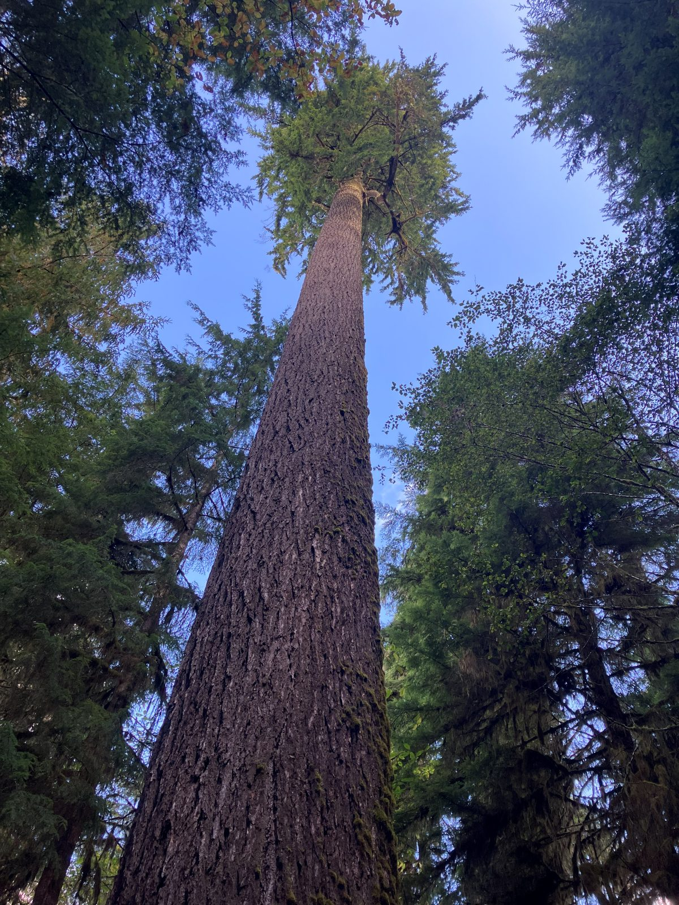{style="border-radius: 6px; width: 100%;"}

{style="border-radius: 6px; width: 100%;"}

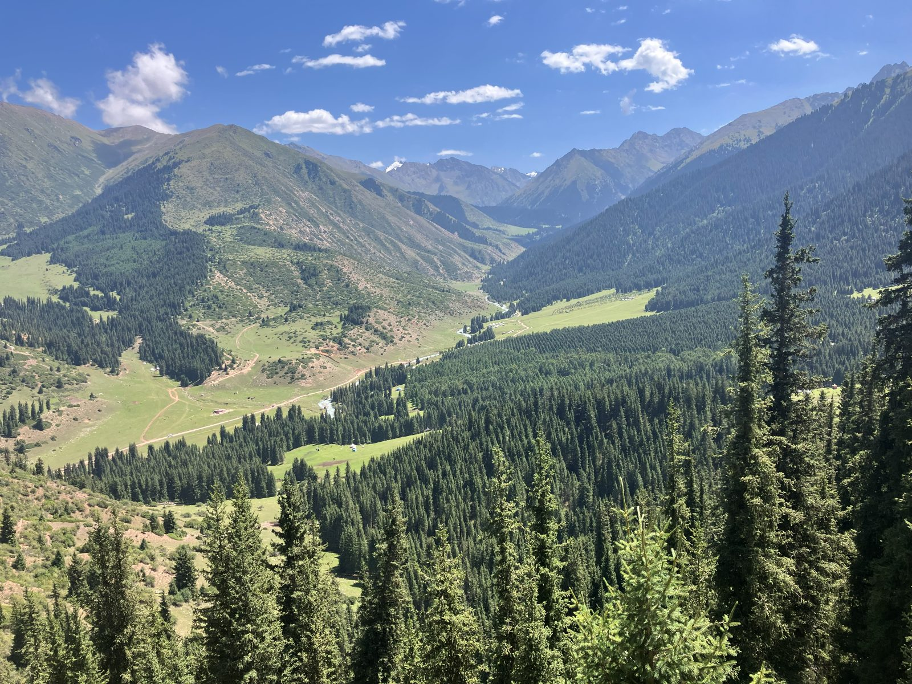{style="border-radius: 6px; width: 100%;"}

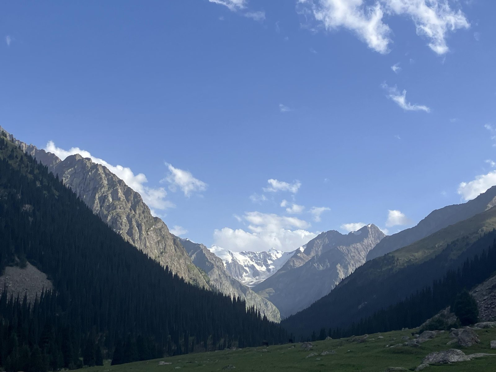{style="border-radius: 6px; width: 100%;"}

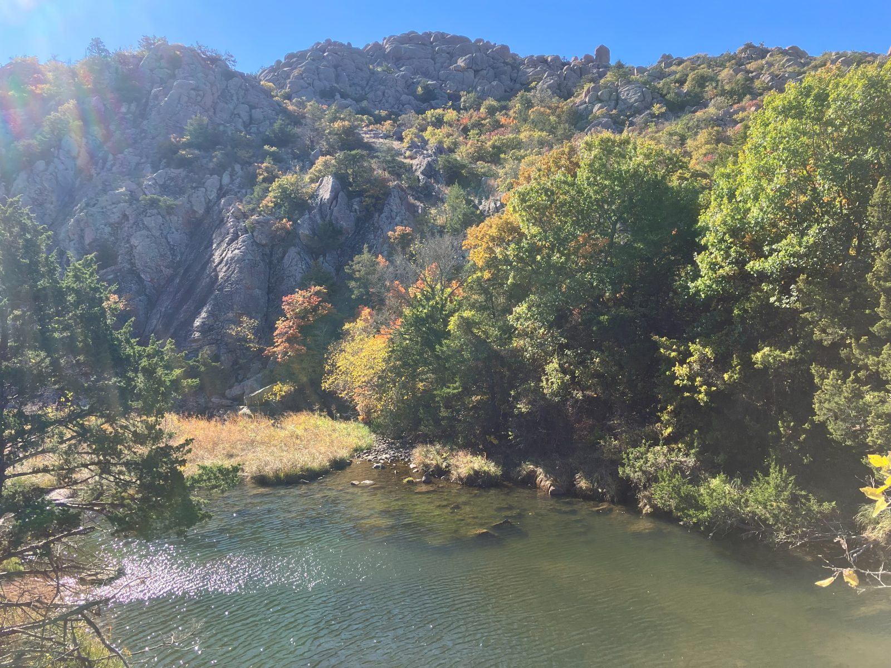{style="border-radius: 6px; width: 100%;"}

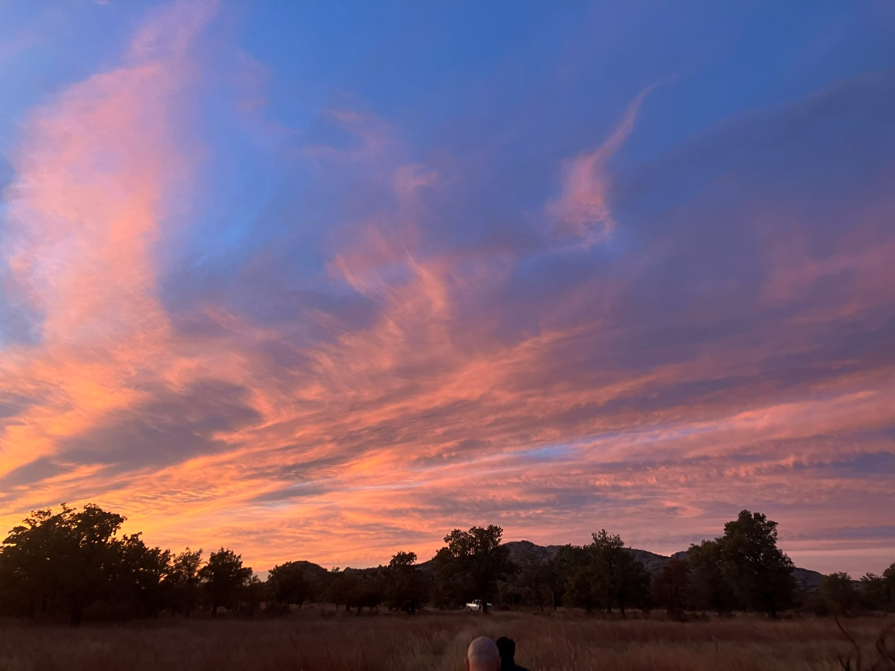{style="border-radius: 6px; width: 100%;"}
:::

### Fieldwork in the Qilian Mountains, Qinghai (2022)

For my M.Sc. I spent the summer of 2022 surveying forests at 2,300–3,000 m in the eastern Qilian Mountains, Qinghai, China — measuring stand structure and collecting tree cores to reconstruct forest growth.

::: {layout-ncol=2}
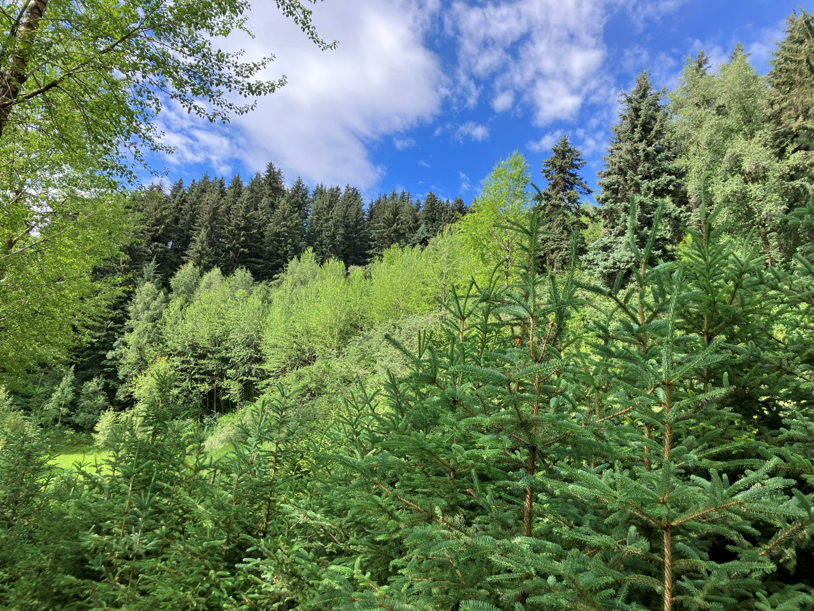{style="border-radius: 6px; width: 100%;"}

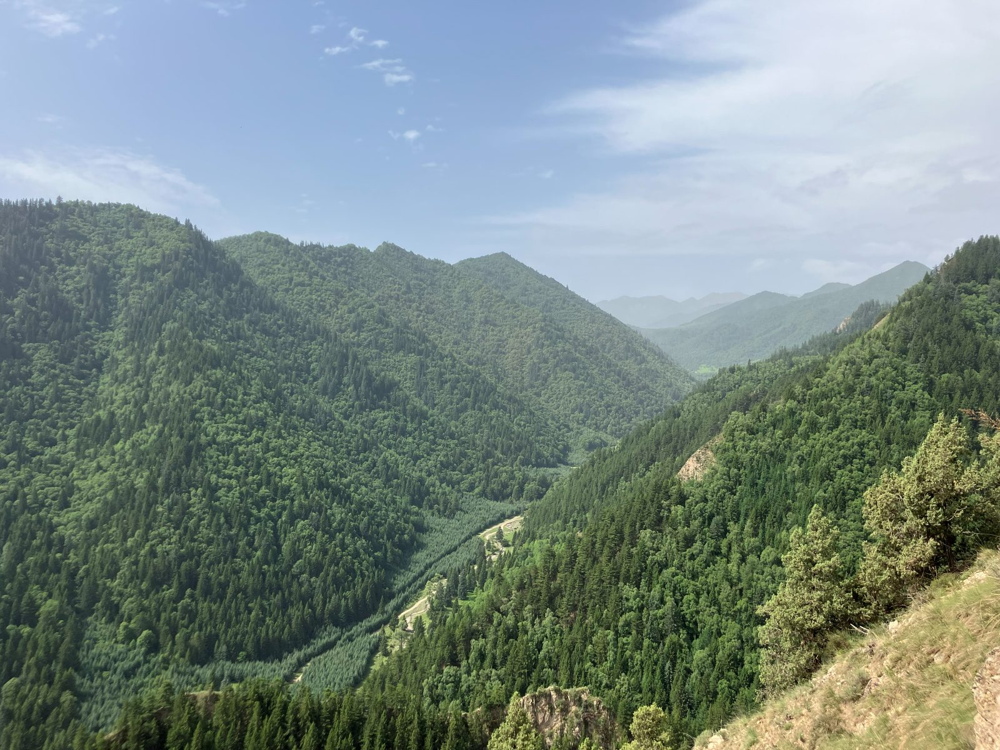{style="border-radius: 6px; width: 100%;"}

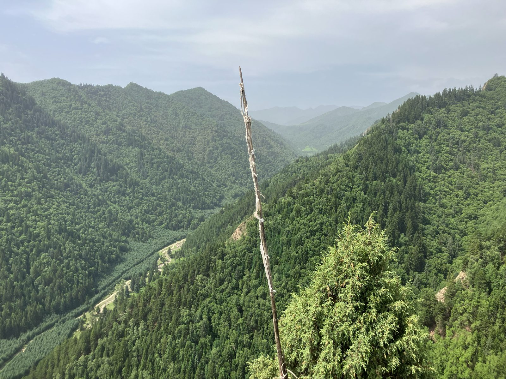{style="border-radius: 6px; width: 100%;"}

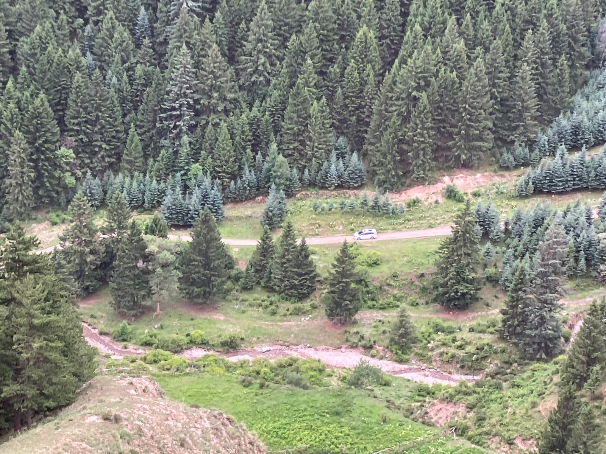{style="border-radius: 6px; width: 100%;"}

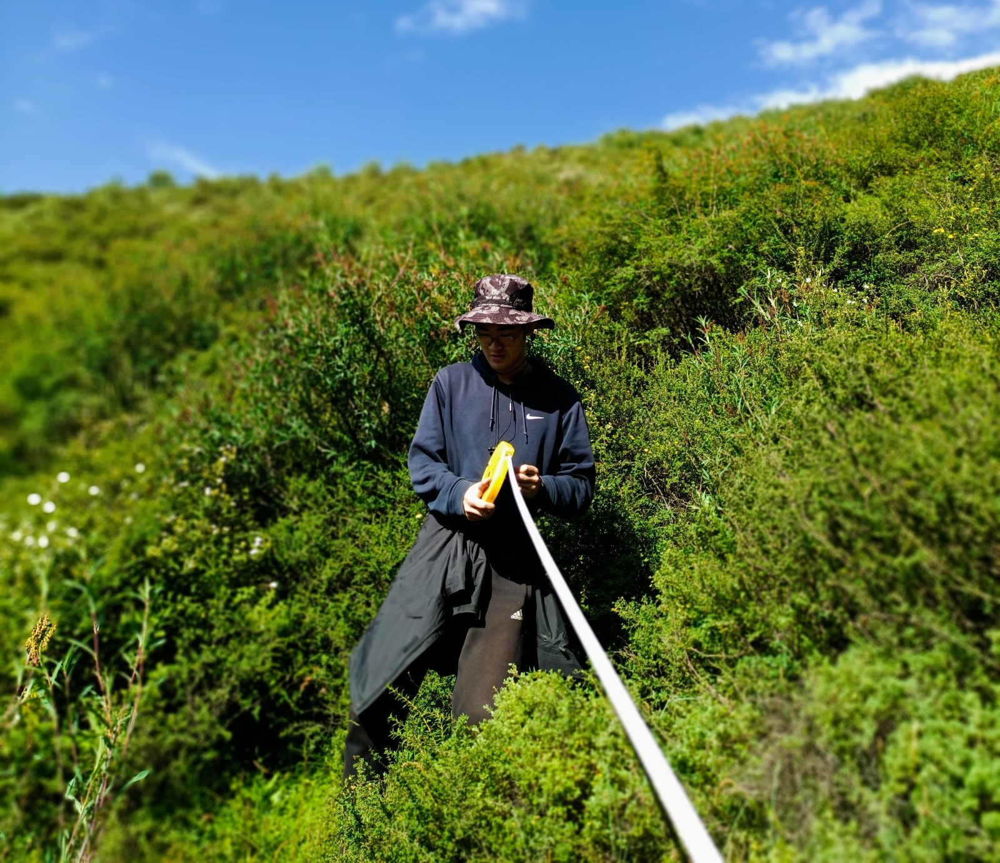{style="border-radius: 6px; width: 100%;"}
:::

---

# Open Science

I believe science advances faster when it is built collectively. In academic practice, I support open and reproducible research — sharing data, code, and workflows wherever possible so that others can build on, verify, and extend the work. Collaboration across labs and disciplines is how we make progress that actually lasts.

[<i class="bi bi-github"></i> GitHub](https://github.com/Programmer112321){.btn .btn-outline-secondary target="_blank"}
[<i class="bi bi-archive"></i> Zenodo](https://zenodo.org/search?q=metadata.creators.person_or_org.name%3A%22Chu%2C%20Dingjin%22&l=list&p=1&s=10&sort=bestmatch){.btn .btn-outline-secondary target="_blank"}

---

# Personal Interest

Hiking, swimming, music, and movie.

## Photos

::: {layout-ncol=2}
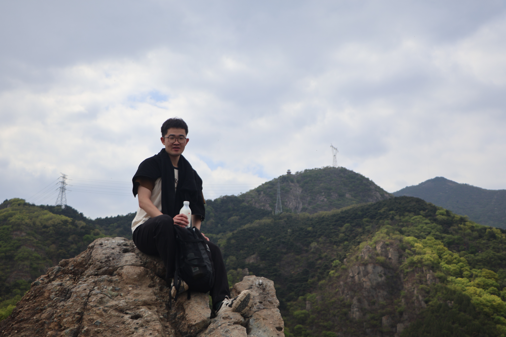{style="border-radius: 6px; width: 100%;"}

{style="border-radius: 6px; width: 100%;"}

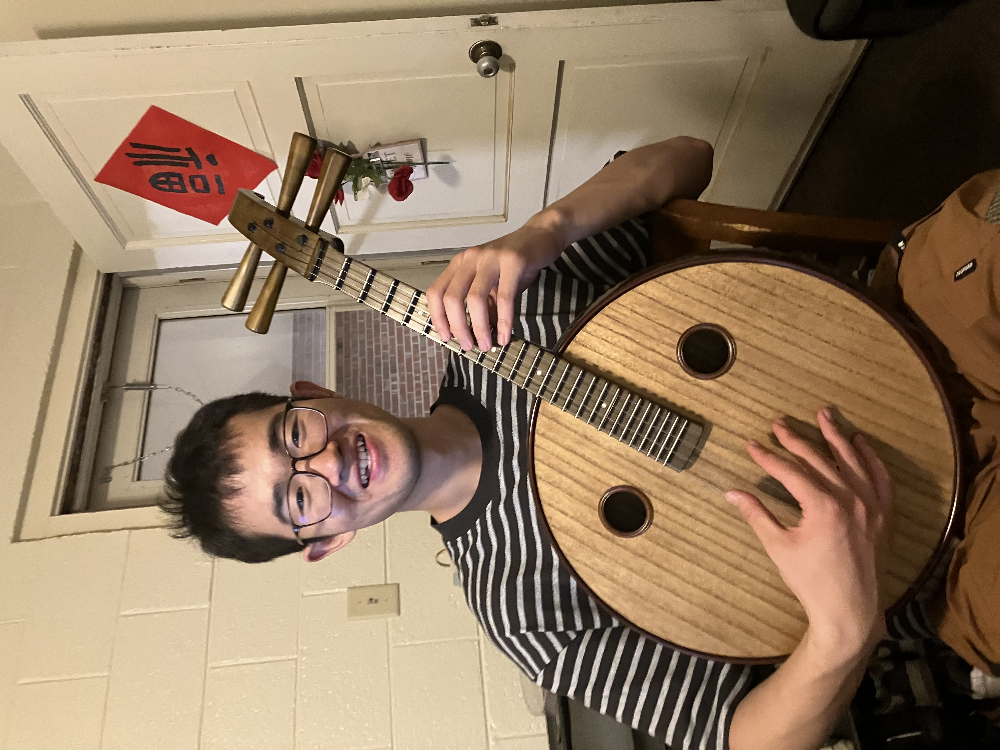{style="border-radius: 6px; width: 100%;"}

{style="border-radius: 6px; width: 100%;"}
:::
