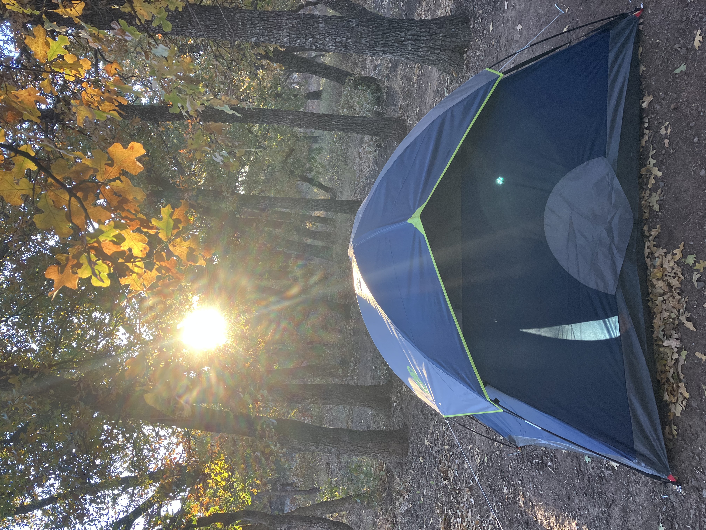

# Curriculum Vitae

[Download CV (PDF)](doc/DingjinChu_CV.pdf){.btn .btn-primary}

<iframe src="doc/DingjinChu_CV.pdf" width="100%" height="900px"
        style="border: 1px solid #dee2e6; border-radius: 6px; margin-top: 1rem;">
</iframe>

---

# Open Science

I believe science advances faster when it is built collectively. In academic practice, I support open and reproducible research — sharing data, code, and workflows wherever possible so that others can build on, verify, and extend the work. Collaboration across labs and disciplines is how we make progress that actually lasts.

[<i class="bi bi-github"></i> GitHub](https://github.com/Programmer112321){.btn .btn-outline-secondary target="_blank"}
[<i class="bi bi-archive"></i> Zenodo](https://zenodo.org/search?q=metadata.creators.person_or_org.name%3A%22Chu%2C%20Dingjin%22&l=list&p=1&s=10&sort=bestmatch){.btn .btn-outline-secondary target="_blank"}

---

# Personal Interest

Hiking, swimming, music, and movie.

## Photos

::: {layout-ncol=2}
{style="border-radius: 6px; width: 100%;"}

{style="border-radius: 6px; width: 100%;"}

{style="border-radius: 6px; width: 100%;"}

{style="border-radius: 6px; width: 100%;"}
:::
