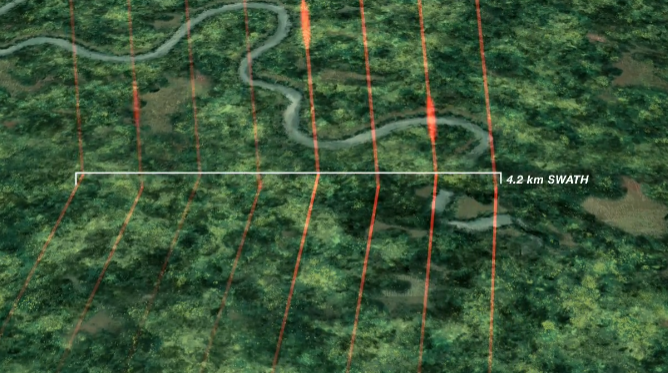

# LiDAR

Notes on LiDAR data processing, analysis, and applications in forest monitoring.

{width="100%" style="border-radius: 6px; margin: 1rem 0;"}

## What is GEDI?

GEDI is a full-waveform LiDAR instrument mounted on the International Space Station. It provides high-resolution measurements of forest vertical structure, canopy height, and above-ground biomass at global scale.

---

# Datasets

The datasets shown here are airborne LiDAR point clouds sourced from the **USGS 3D Elevation Program (3DEP)** — a nationwide initiative to collect high-quality topographic data across the United States. Data are freely available through the [USGS National Map](https://www.usgs.gov/3d-elevation-program).

---

## Urban Forest — Near Central Park, New York City

**Source:** USGS 3DEP · NAD83(2011) / UTM Zone 18N
**Area:** ~2.04 km² · **Points:** 2.21 million · **Density:** ~1.08 pts/m²
**Elevation range:** −10 m to +385 m (ground to building rooftops)

This tile covers a section of Manhattan adjacent to Central Park. The map below shows the exact footprint of the dataset on a satellite basemap — toggle the minimap in the bottom-right corner for broader context.

<iframe src="widgets/central_park_map.html"
        width="100%" height="420px"
        style="border: 1px solid #dee2e6; border-radius: 6px; margin-bottom: 1rem;"
        frameborder="0">
</iframe>

The 3D viewer below renders the point cloud colored by elevation. Rotate with left-click, pan with right-click, and scroll to zoom. The tall peaks (orange–red) are Manhattan skyscrapers; the flat ground surface and below-grade infrastructure appear in purple–blue.

<iframe src="widgets/central_park_3d.html"
        width="100%" height="580px"
        style="border: 1px solid #dee2e6; border-radius: 6px;"
        frameborder="0">
</iframe>

---

## Small Tree Plot

**Source:** USGS 3DEP · WGS 84 / UTM Zone 6N
**Area:** ~399 m² · **Points:** 10.4 thousand · **Density:** ~26 pts/m²
**Elevation range:** 0 m to 17.3 m (ground to crown top)

A high-density scan (~20 m × 20 m) of a small tree stand. At 26 pts/m² the scan resolves individual tree crowns and branching structure in detail. All points are shown — no subsampling. Colors show elevation from ground (dark green) to canopy top (yellow).

<iframe src="widgets/tree_3d.html"
        width="100%" height="550px"
        style="border: 1px solid #dee2e6; border-radius: 6px;"
        frameborder="0">
</iframe>

---

::: {.callout-note}
All data are from the [USGS 3D Elevation Program (3DEP)](https://www.usgs.gov/3d-elevation-program) and are in the public domain. Visualizations produced with `lidR`, `plotly`, and `leaflet` in R.
:::
