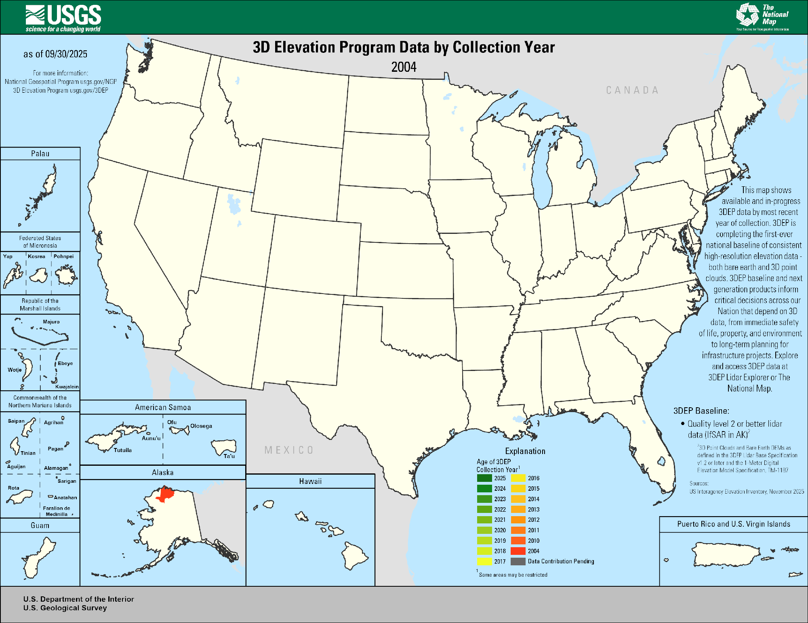

LiDAR datasets organized by acquisition platform — airborne, spaceborne, and ground-based terrestrial scanners — plus derived global products and multi-source data portals.

::: {style="display:flex; flex-wrap:wrap; gap:0.5rem; margin:1rem 0 1.5rem 0; padding:0.85rem 1rem; background:rgba(0,0,0,0.03); border-radius:8px;"}
[Airborne LiDAR](#airborne){.btn .btn-outline-secondary .btn-sm}
[Spaceborne LiDAR](#spaceborne){.btn .btn-outline-secondary .btn-sm}
[Terrestrial LiDAR](#terrestrial){.btn .btn-outline-secondary .btn-sm}
[Data Portals](#portals){.btn .btn-outline-secondary .btn-sm}
:::

---

## Airborne LiDAR {#airborne}

Airborne discrete-return and full-waveform LiDAR sensors flown on aircraft, providing high-density point clouds for terrain mapping, forest structure, and urban analysis.

---

### USGS 3DEP — Urban Forest Near Central Park, New York City

The datasets shown here are airborne LiDAR point clouds from two open-access programs: the **USGS 3D Elevation Program (3DEP)**, a nationwide topographic mapping initiative, and the **NEON Airborne Observation Platform (AOP)**, which collects high-density ecological LiDAR across NEON field sites. Both programs provide data freely to the public.

**Source:** USGS 3DEP · NAD83(2011) / UTM Zone 18N
**Area:** ~2.04 km² · **Points:** 2.21 million · **Density:** ~1.08 pts/m²
**Elevation range:** −10 m to +385 m (ground to building rooftops)

{width="100%" style="border-radius:6px; margin-bottom:0.75rem;"}

This tile covers a section of Manhattan adjacent to Central Park. The map below shows the exact footprint of the dataset on a satellite basemap.

<iframe src="widgets/central_park_map.html"
        width="100%" height="420px"
        style="border: 1px solid #dee2e6; border-radius: 6px; margin-bottom: 1rem;"
        frameborder="0">
</iframe>

The 3D viewer below renders the point cloud colored by elevation. Rotate with left-click, pan with right-click, and scroll to zoom. The tall peaks (orange–red) are Manhattan skyscrapers; the flat ground surface and below-grade infrastructure appear in purple–blue.

<iframe src="widgets/central_park_3d.html"
        width="100%" height="580px"
        style="border: 1px solid #dee2e6; border-radius: 6px;"
        frameborder="0">
</iframe>

---

### NEON AOP — Small Tree Plot

**Source:** NEON Airborne Observation Platform · WGS 84 / UTM Zone 6N
**Area:** ~399 m² · **Points:** 10.4 thousand · **Density:** ~26 pts/m²
**Elevation range:** 0 m to 17.3 m (ground to crown top)

A high-density NEON AOP scan (~20 m × 20 m) of a small tree stand. At 26 pts/m² the scan resolves individual tree crowns and branching structure in detail. All points are shown — no subsampling. Colors show elevation from ground (dark green) to canopy top (yellow).

<iframe src="widgets/tree_3d.html"
        width="100%" height="550px"
        style="border: 1px solid #dee2e6; border-radius: 6px;"
        frameborder="0">
</iframe>

---

### LVIS — Land, Vegetation, and Ice Sensor (NASA)

**LVIS** is a NASA airborne full-waveform LiDAR system designed for high-sensitivity vegetation and ice surface profiling. Unlike discrete-return systems, LVIS records the complete waveform of each laser return, enabling retrieval of canopy vertical structure (plant area index, foliage profiles) and ground elevation simultaneously — similar to GEDI but from airborne campaigns with higher density.

**Agency:** NASA Goddard Space Flight Center
**Sensor:** Full-waveform 1064 nm LiDAR (airborne)
**Footprint size:** ~10–25 m diameter (varies with aircraft altitude)
**Along-track density:** Variable; typically higher than spaceborne systems (~1–5 footprints/m along-track)
**Coverage:** Campaign-based; missions include Amazon, Congo, boreal forests (Canada/Alaska), Greenland Ice Sheet, Antarctic Peninsula, African savannas
**Key products:** Ground elevation, canopy top height, waveform-derived plant area density profiles, RH metrics comparable to GEDI
**Key applications:** Forest biomass calibration/validation, tropical and boreal canopy structure, ice surface change, comparison studies with GEDI and ICESat-2

::: {.callout-note}
LVIS data are freely available through [NASA EarthData](https://earthdata.nasa.gov) and the [LVIS project website](https://lvis.gsfc.nasa.gov).
:::

---

## Spaceborne LiDAR {#spaceborne}

Satellite-borne LiDAR instruments providing global coverage of surface elevation, canopy height, and biomass at footprint scales.

---

### GEDI

{width="100%" style="border-radius: 6px; margin: 1rem 0;"}

GEDI is a full-waveform LiDAR instrument mounted on the International Space Station. It provides high-resolution measurements of forest vertical structure, canopy height, and above-ground biomass at global scale.

**Agency:** NASA Goddard Space Flight Center
**Sensor:** Three 1064 nm full-waveform LiDAR lasers
**Footprint size:** ~25 m diameter
**Along-track spacing:** ~60 m · **Cross-track spacing:** ~600 m
**Coverage:** ~51.6°N to 51.6°S (ISS orbital range)
**Key products:** Canopy height (RH metrics), Plant Area Index (PAI), Above-ground biomass density (AGBD)

::: {.callout-note}
GEDI data are freely available through [NASA EarthData](https://earthdata.nasa.gov) and [Google Earth Engine](https://earthengine.google.com).
:::

---

### ICESat-2 — NASA

**ICESat-2** (Ice, Cloud, and land Elevation Satellite-2) uses a photon-counting LiDAR (ATLAS) to measure surface elevation globally with centimeter-level precision. While primarily designed for ice sheet and sea ice monitoring, ICESat-2 is increasingly used for global forest canopy height estimation and terrain mapping.

**Agency:** NASA Goddard Space Flight Center
**Sensor:** ATLAS (Advanced Topographic Laser Altimeter System) — 532 nm photon-counting LiDAR
**Footprint size:** ~17 m diameter
**Along-track spacing:** ~0.7 m (photon level)
**Beam configuration:** 3 pairs of strong/weak beams (6 beams total)
**Temporal resolution:** 91-day exact repeat cycle
**Coverage:** Global, up to ±88° latitude
**Key products:**
- **ATL03** — Global geolocated photons
- **ATL06** — Land ice surface height
- **ATL08** — Land and vegetation height (canopy top, terrain)
- **ATL13** — Inland water surface height
**Key applications:** Forest canopy height, ice sheet mass balance, sea ice freeboard, lake and river water levels, terrain DEM

::: {.callout-note}
ICESat-2 data are freely available through [NASA EarthData](https://earthdata.nasa.gov) and [OpenAltimetry](https://openaltimetry.earthdatacloud.nasa.gov).
:::

---

## Terrestrial LiDAR {#terrestrial}

Ground-based Terrestrial Laser Scanning (TLS) instruments measure three-dimensional forest or ecosystem structure at millimeter-to-centimeter resolution from fixed scan positions. TLS is the only approach that resolves individual trunk geometry, branch architecture, and leaf-level canopy structure within a plot, making it the gold standard for validating airborne and spaceborne biomass estimates.

---

### NEON Terrestrial LiDAR Scanning (TLS)

**NEON** deploys a tripod-mounted terrestrial laser scanner at field sites across the United States as part of its standardized ecological observatory program. TLS scans are co-located with NEON woody plant vegetation structure plots and NEON AOP airborne collections, enabling direct multi-scale comparisons from individual stems to landscape.

**Agency:** National Ecological Observatory Network (NEON / Battelle)
**Product code:** DP1.10098.001 — Terrestrial Lidar Scanning
**Sensor:** RIEGL VZ-400 or equivalent phase-based/time-of-flight scanner
**Scan density:** Typically >1,000 pts/m² within 30–50 m of scan position
**Coverage:** 47 NEON terrestrial field sites across 20 eco-climatic domains (CONUS, Alaska, Hawaii, Puerto Rico)
**Temporal coverage:** Ongoing from ~2017; most sites have ≥3 annual scan campaigns
**Key variables:** 3D point cloud of plot-level forest structure; co-registered multiple scan positions per plot
**Key applications:** Individual tree volume estimation, allometric model calibration, canopy gap fraction, validation of GEDI/ICESat-2/airborne AGB estimates, 4D change detection of tree growth and mortality

::: {.callout-note}
NEON TLS data (DP1.10098.001) are freely available through the [NEON Data Portal](https://data.neonscience.org). The `neonUtilities` R package and `neonstore` simplify bulk download and processing.
:::

---

### Community TLS Forest Benchmark Datasets

A growing body of research groups have deposited open TLS forest datasets on **Zenodo** and **PANGAEA** as community benchmarks for testing biomass estimation, tree segmentation, and canopy modeling methods. These range from single-site campaigns to multi-continent compilations.

**Notable public deposits include:**

| Dataset | Coverage | Resolution | Repository |
|---|---|---|---|
| Global TLS forest dataset (Brede et al.) | Temperate & tropical plots, Europe/tropics | ~5–50 pts/cm² | Zenodo |
| ForestScan benchmark plots (UCL) | UK broadleaf and conifer plots | High-density multi-scan | Zenodo |
| Estonian TLS forest plots | Boreal hemi-boreal plots, 20+ sites | ~10 pts/cm² | PANGAEA |
| TERN Supersite TLS (Australia) | Tropical savanna and eucalypt forest | Multi-scan mosaic | TERN Data Portal |

**Typical variables available:** 3D point cloud (LAS/LAZ format), co-registered multi-scan mosaic, plot-level metadata (species, DBH, height), sometimes co-located destructive biomass measurements for allometric validation.

**Key applications:** Allometric model validation, non-destructive biomass estimation, tree segmentation algorithm testing, leaf-on/leaf-off structure comparison, plant area index retrieval

::: {.callout-tip}
The `lidR` (R) and `laspy`/`open3d` (Python) libraries are the standard tools for processing TLS point clouds. The `RQSM` (R) and `TreeQSM` (MATLAB) packages reconstruct quantitative structural models (QSM) of individual trees from TLS data, enabling non-destructive volume and biomass estimation.
:::

::: {.callout-note}
Search [Zenodo.org](https://zenodo.org) with keywords "terrestrial lidar forest" or "TLS forest point cloud" to discover community benchmark deposits. [PANGAEA](https://www.pangaea.de) also hosts TLS datasets from research expeditions. Australian TLS data are available via the [TERN Data Portal](https://portal.tern.org.au).
:::

---

## Data Portals {#portals}

Multi-source aggregation platforms that host and serve LiDAR point clouds and DEMs from many independent campaigns through a single discovery and download interface.

---

### OpenTopography — Multi-Source LiDAR and DEM Portal

**OpenTopography** is an NSF-funded data portal that provides free, open access to high-resolution LiDAR point clouds, DEMs, and derived products from dozens of airborne LiDAR campaigns and global raster elevation datasets. It serves as a one-stop discovery and processing platform for a wide variety of LiDAR archives.

**Operator:** San Diego Supercomputer Center (SDSC), UNAVCO, and Arizona State University (NSF-funded)
**Data types available:**
- **Airborne LiDAR point clouds** — NCALM, B4 Fault Zone, EarthScope campaigns, CoastalDEM collections
- **Global DEMs** — SRTM (30 m/90 m), ALOS World 3D (30 m), CopDEM (30 m/90 m), TanDEM-X (90 m public release)
- **Community-contributed datasets** — Research-grade campaigns from universities and agencies worldwide
**Spatial resolution:** Ranges from ~0.25 m (high-density airborne LiDAR) to 30–90 m (global DEMs)
**On-demand processing:** Users can request point cloud derivatives (bare-earth DEM, DSM, slope, hillshade) processed directly in the cloud without local downloads
**Key applications:** Geomorphology, fault mapping, forest structure, urban morphology, coastal change, landslide monitoring

::: {.callout-note}
OpenTopography datasets are freely accessible at [OpenTopography.org](https://opentopography.org). Many datasets also offer direct API access for programmatic download.
:::

---

::: {.callout-note}
USGS 3DEP data are available via the [USGS National Map](https://www.usgs.gov/3d-elevation-program). NEON AOP data are available via the [NEON Data Portal](https://data.neonscience.org). Visualizations produced with `lidR`, `plotly`, and `leaflet` in R.
:::
