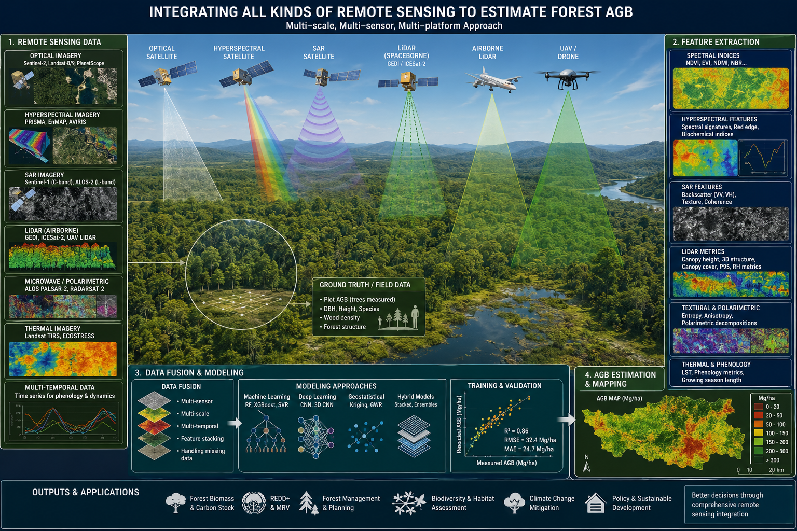
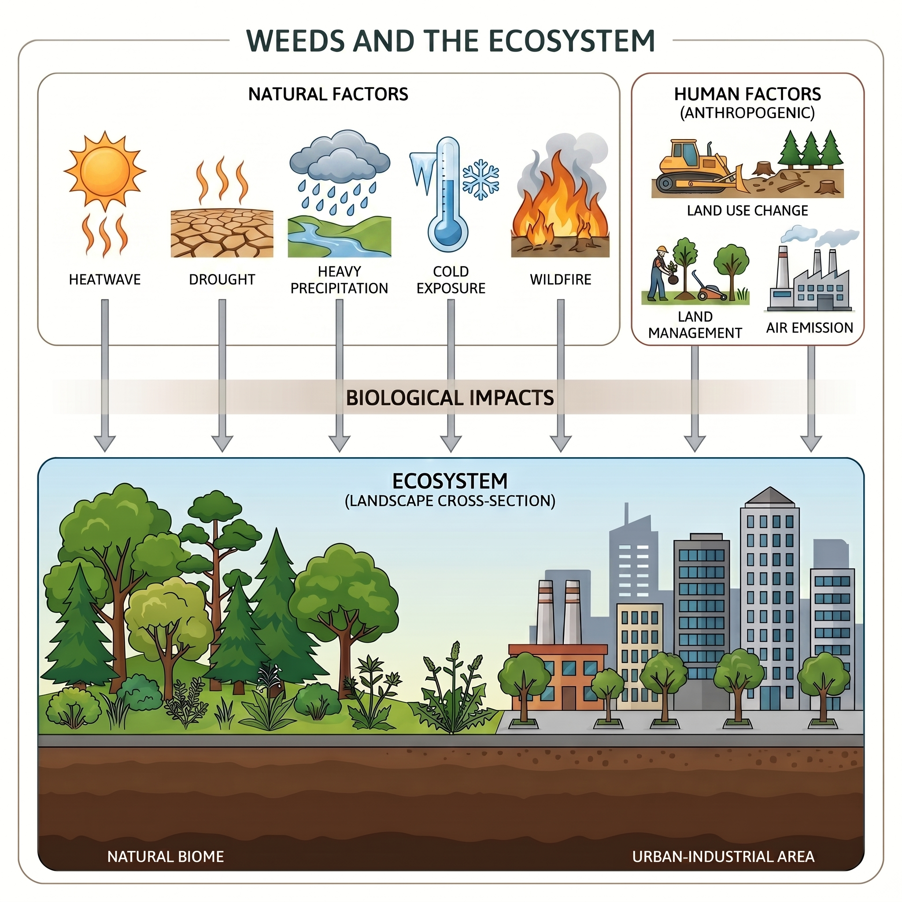
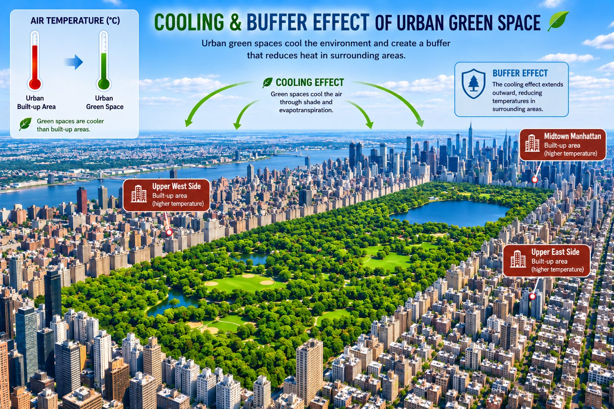

```{=html}
<style>#title-block-header, header.quarto-title-block { display: none !important; } #quarto-content, #quarto-content.page-layout-custom, main.content { max-width: none !important; margin: 0 !important; padding: 0 !important; }</style>
<div class="hp-home">

<!-- ── Hero ─────────────────────────────────────────────── -->
<section class="hp-hero">
  <div class="hp-wrap hp-hero-grid">
    <div>
      <div class="hp-kicker">Natural Resource Ecology &amp; Management · Oklahoma State University</div>
      <h1>Dingjin Chu<span class="hp-cn">初鼎晋</span></h1>
      <p class="hp-lead">I study how forests store carbon, how they respond to climate extremes, and how much they cool our cities — combining field inventories, multi-scale LiDAR and satellite records with interpretable models.</p>
      <p class="hp-role">Ph.D. Student · Land Surface Ecology &amp; Geospatial Science · Advisor: Dr. Lu Zhai</p>
      <div class="hp-actions">
        <a class="btn btn-primary" href="projects_intro.html">Research</a>
        <a class="btn btn-outline-primary" href="publications.html">Publications</a>
        <a class="btn btn-outline-primary" href="doc/DingjinChu_CV.pdf">CV</a>
      </div>
    </div>
    <div>
      <div class="hp-globe-box" aria-label="Interactive true-colour globe of the Earth">
        <div class="hp-globe-fallback"></div>
        <div id="hp-globe"></div>
      </div>
    </div>
  </div>
</section>

<!-- ── About ────────────────────────────────────────────── -->
<section class="hp-sec">
  <div class="hp-wrap hp-split hp-reveal">
    <div class="hp-side">
      <h2 class="hp-h2">About</h2>
      <a class="hp-more" href="cv.html">More about me →</a>
    </div>
    <div class="hp-prose">
      <p>My research asks questions such as: <em>Can a global biomass map be trusted to report the carbon in a local forest? Which forests hold their biomass through drought? Why do some urban forests cool their surroundings far more than others?</em></p>
      <p>To answer them, I combine field inventories (FIA, NEON) with airborne, spaceborne and terrestrial LiDAR and multi-decadal satellite records — see <a href="datasets_intro.html">Datasets</a> — and analyze them with statistical models, interpretable machine learning and process-based models — see <a href="methods_intro.html">Methods</a>.</p>
      <p class="hp-motto">Explore important <a href="projects_intro.html">research</a> questions using robust <a href="datasets_intro.html">datasets</a> and rigorous <a href="methods_intro.html">methods</a> under well-defined <a href="methods_assumptions.html">assumptions</a>.</p>
    </div>
  </div>
</section>

<!-- ── News ─────────────────────────────────────────────── -->
<section class="hp-sec">
  <div class="hp-wrap hp-split hp-reveal">
    <div class="hp-side">
      <h2 class="hp-h2">News</h2>
      <a class="hp-more" href="news.html">All news →</a>
    </div>
    <ul class="hp-news">
      <li><span class="hp-date">2026-10-20</span><span class="hp-tag">Honour</span><span class="hp-news-title">Third place, Student Poster Competition, GIS Day at OSU</span></li>
      <li><span class="hp-date">2026-10-08</span><span class="hp-tag">Talk · Poster</span><span class="hp-news-title">Urban forest cooling talk and biomass-map poster at the SAF National Convention, Tacoma</span></li>
      <li><span class="hp-date">2026</span><span class="hp-tag">Preprint</span><span class="hp-news-title"><a href="https://doi.org/10.2139/ssrn.7287457" target="_blank">Local-scale bias in global forest biomass products</a> posted on SSRN</span></li>
      <li><span class="hp-date">2026-05-14</span><span class="hp-tag">Publication</span><span class="hp-news-title"><a href="https://doi.org/10.1088/1748-9326/ae6dd4" target="_blank">Climate extremes and productivity variability in Central Asia</a>, <em>Environmental Research Letters</em></span></li>
      <li><span class="hp-date">2026-04</span><span class="hp-tag">Talk</span><span class="hp-news-title">Global biomass maps on Tribal Nations' lands, Natural Resource Conference, Oklahoma City</span></li>
    </ul>
  </div>
</section>

<!-- ── Research ─────────────────────────────────────────── -->
<section class="hp-sec hp-sky" id="research">
  <div class="hp-wrap">
    <div class="hp-head-row hp-reveal">
      <h2 class="hp-h2">Research</h2>
      <a class="hp-more" href="projects_intro.html">All research →</a>
    </div>
    <div class="hp-cards">
      <a class="hp-card hp-reveal" href="projects_forest_agb.html">
        
        <div class="hp-card-body">
          <div class="hp-chips"><span class="hp-chip">LiDAR</span><span class="hp-chip">GEDI</span><span class="hp-chip">Forest inventory</span></div>
          <h3>Forest Above-Ground Biomass</h3>
          <p>How accurate are global biomass maps at local scales, and how can multi-scale LiDAR make them better?</p>
        </div>
      </a>
      <a class="hp-card hp-reveal" href="projects_disturbance.html">
        
        <div class="hp-card-body">
          <div class="hp-chips"><span class="hp-chip">Drought</span><span class="hp-chip">CMIP6</span><span class="hp-chip">Stability</span></div>
          <h3>Ecosystem Response to Disturbances</h3>
          <p>How climate extremes change the productivity and stability of ecosystems, from Central Asia to U.S. forests.</p>
        </div>
      </a>
      <a class="hp-card hp-reveal" href="projects_urban.html">
        
        <div class="hp-card-body">
          <div class="hp-chips"><span class="hp-chip">Landsat LST</span><span class="hp-chip">Canopy</span><span class="hp-chip">Heat equity</span></div>
          <h3>Cooling Effect of Urban Green Space</h3>
          <p>Which urban forests cool cities most, why, and who benefits from that cooling.</p>
        </div>
      </a>
    </div>
  </div>
</section>

<!-- ── Representative work ──────────────────────────────── -->
<section class="hp-sec">
  <div class="hp-wrap">
    <div class="hp-head-row hp-reveal">
      <h2 class="hp-h2">Representative work</h2>
      <a class="hp-more" href="publications.html">All publications →</a>
    </div>
    <div class="hp-feat hp-reveal">
      <div class="hp-feat-fig"></div>
      <div>
        <span class="hp-venue">Environmental Research Letters</span><span class="hp-badges"><span class="hp-badge">2026</span><span class="hp-badge">Article</span></span>
        <h3>Future climate extremes enhance interannual variability of net primary production in Central Asia</h3>
        <div class="hp-authors"><strong>Chu, D.</strong>, Zhang, L., Wu, H., He, H., &amp; Ren, X.</div>
        <p>Using CMIP6 projections, intensifying droughts, heatwaves and wet extremes are shown to amplify year-to-year swings in plant productivity across Central Asia's drylands, making carbon uptake less predictable under warming.</p>
        <a class="btn btn-outline-primary" href="https://doi.org/10.1088/1748-9326/ae6dd4" target="_blank">Read paper</a>
      </div>
    </div>
    <div class="hp-feat hp-reveal">
      <div class="hp-feat-fig"></div>
      <div>
        <span class="hp-venue">SSRN</span><span class="hp-badges"><span class="hp-badge">2026</span><span class="hp-badge">Preprint</span></span>
        <h3>Local-scale bias in global products of forest aboveground biomass related to structural diversity, stand density, and forest age</h3>
        <div class="hp-authors"><strong>Chu, D.</strong>, Yang, H., Costanza, J. K., Yang, J., Murray, B., Mosely, J., &amp; Zhai, L.</div>
        <p>ESA CCI and GEDI L4B biomass are checked against national forest inventory data on U.S. Tribal lands. Both overestimate, the bias tracks stand structure and age, and correction models cut the prediction error by more than half.</p>
        <a class="btn btn-outline-primary" href="https://doi.org/10.2139/ssrn.7287457" target="_blank">Read preprint</a>
      </div>
    </div>
  </div>
</section>

<!-- ── Contact ──────────────────────────────────────────── -->
<section class="hp-sec hp-sky" id="contact-me">
  <div class="hp-wrap hp-split hp-reveal">
    <div class="hp-side hp-contact-meta">
      <h2 class="hp-h2">Contact</h2>
      <p class="mt-3">I am open to collaborations and scientific projects in remote sensing, LiDAR and environmental data science.</p>
      <p><i class="bi bi-envelope me-2"></i><a href="mailto:dingjinchu@gmail.com">dingjinchu@gmail.com</a></p>
      <p><i class="bi bi-geo-alt me-2"></i>Agricultural Hall, Oklahoma State University, Stillwater, OK</p>
      <div class="d-flex gap-2 mt-3">
        <a href="https://www.linkedin.com/in/dingjin-chu-892ba7352/" target="_blank" class="btn btn-outline-primary btn-sm" title="LinkedIn"><i class="bi bi-linkedin"></i></a>
        <a href="https://github.com/Programmer112321" target="_blank" class="btn btn-outline-primary btn-sm" title="GitHub"><i class="bi bi-github"></i></a>
        <a href="https://scholar.google.com/citations?user=XzIFKvMAAAAJ&amp;hl=en" target="_blank" class="btn btn-outline-primary btn-sm" title="Google Scholar"><i class="bi bi-mortarboard-fill"></i></a>
      </div>
    </div>
    <form id="contactFormHome" onsubmit="submitContactHome(event)">
      <div class="row g-3">
        <div class="col-md-6"><label class="form-label">Full name <span class="text-danger">*</span></label><input type="text" id="h-name" class="form-control" required></div>
        <div class="col-md-6"><label class="form-label">Email <span class="text-danger">*</span></label><input type="email" id="h-email" class="form-control" required></div>
        <div class="col-md-6"><label class="form-label">Affiliation <span class="text-danger">*</span></label><input type="text" id="h-affiliation" class="form-control" required></div>
        <div class="col-md-6"><label class="form-label">Position <span class="text-danger">*</span></label><input type="text" id="h-position" class="form-control" required></div>
        <div class="col-12"><label class="form-label">Message <span class="text-danger">*</span></label><textarea id="h-message" class="form-control" rows="5" placeholder="Enter your message" required></textarea></div>
        <div class="col-12"><button type="submit" class="btn btn-primary px-4">Send</button></div>
      </div>
    </form>
  </div>
</section>

</div>

<script>
function submitContactHome(e) {
  e.preventDefault();
  var name        = document.getElementById('h-name').value;
  var email       = document.getElementById('h-email').value;
  var affiliation = document.getElementById('h-affiliation').value;
  var position    = document.getElementById('h-position').value;
  var message     = document.getElementById('h-message').value;
  var subject     = encodeURIComponent('Message from ' + name);
  var body        = encodeURIComponent(
    'Name: ' + name + '\r\n' +
    'Email: ' + email + '\r\n' +
    'Affiliation: ' + affiliation + '\r\n' +
    'Position: ' + position + '\r\n\r\n' +
    'Message:\r\n' + message
  );
  window.location.href = 'mailto:dingjinchu@gmail.com?subject=' + subject + '&body=' + body;
}

/* reveal sections as they scroll into view */
(function () {
  if (!('IntersectionObserver' in window)) return;
  document.documentElement.classList.add('hp-anim');
  var io = new IntersectionObserver(function (entries) {
    entries.forEach(function (en) {
      if (en.isIntersecting) { en.target.classList.add('hp-in'); io.unobserve(en.target); }
    });
  }, { threshold: 0.12 });
  document.querySelectorAll('.hp-reveal').forEach(function (el) { io.observe(el); });
})();
</script>
<script src="assets/home-globe.js" defer></script>
```
