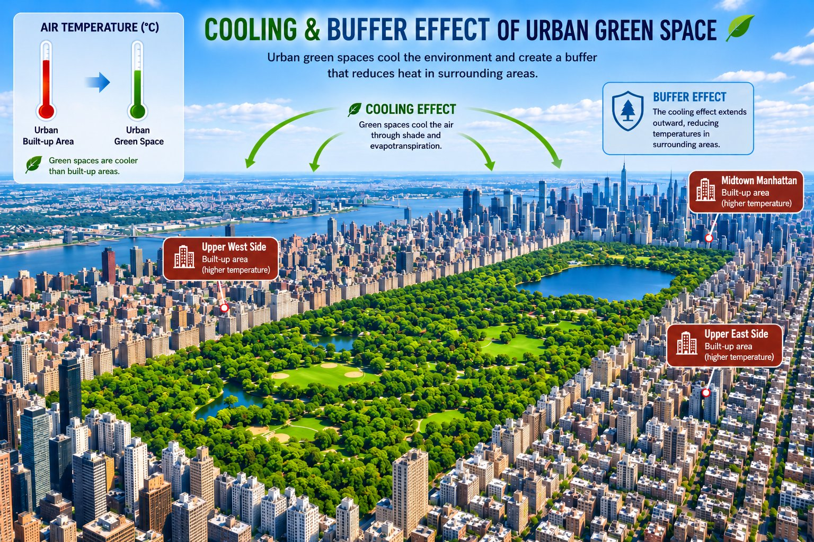

**PhD Student** · Land Surface Ecology & Geospatial Science

[Department of Natural Resource Ecology & Management](https://go.okstate.edu/undergraduate-academics/majors/natural-resource-ecology-and-management) · [Oklahoma State University](https://go.okstate.edu/)

---

## 👋 Hello, this is Dingjin.

*Explore important [research](projects_intro.qmd) questions using robust [datasets](datasets_intro.qmd) and rigorous [methods](methods_intro.qmd) under well-defined [assumptions](methods_assumptions.qmd).*

---

I study how forests store carbon, how they respond to climate extremes, and how much they cool our cities. My work asks questions such as: *Can a global biomass map be trusted to report the carbon in a local forest? Which forests hold their biomass through drought? Why do some urban forests cool their surroundings far more than others?* Read more in the [Research](projects_intro.qmd) section.

To answer them, I combine field inventories (FIA, NEON) with airborne, spaceborne and terrestrial LiDAR and multi-decadal satellite records — see [Datasets](datasets_intro.qmd) — and analyze them with statistical models, interpretable machine learning and process-based models — see [Methods](methods_intro.qmd).

**Latest:** I presented a talk on urban forest cooling and a poster on biomass-map bias at the [SAF National Convention](news.qmd) (Oct 2026), and my paper on climate extremes and productivity variability in Central Asia is out in [*Environmental Research Letters*](https://doi.org/10.1088/1748-9326/ae6dd4).

---

## Research Areas

::: {.grid}
::: {.g-col-12 .g-col-md-4}
[{style="border-radius:8px; width:100%; aspect-ratio:4/3; object-fit:cover;"}](projects_forest_agb.qmd)

**[Forest Above-Ground Biomass](projects_forest_agb.qmd)**<br>
Multi-scale LiDAR and the local accuracy of biomass maps.
:::
::: {.g-col-12 .g-col-md-4}
[{style="border-radius:8px; width:100%; aspect-ratio:4/3; object-fit:cover;"}](projects_disturbance.qmd)

**[Response to Disturbances](projects_disturbance.qmd)**<br>
Climate extremes, productivity variability and forest stability.
:::
::: {.g-col-12 .g-col-md-4}
[{style="border-radius:8px; width:100%; aspect-ratio:4/3; object-fit:cover;"}](projects_urban.qmd)

**[Urban Green Space Cooling](projects_urban.qmd)**<br>
How canopy, climate and buildings shape urban cooling.
:::
:::

---

 — NASA.*](photo/research/Bottom_photo_created_by_yourname_landsat.png){width="100%"}

---

## Contact Me

```{=html}
<div class="row g-5 mt-1">
  <div class="col-md-5">
    <p>Feel free to get in touch for any inquiries or opportunities. I am open to collaborations, scientific projects, and job opportunities where I can contribute my expertise in remote sensing, LiDAR, and environmental data science.</p>
    <p class="mt-4"><i class="bi bi-envelope me-2"></i><a href="mailto:dingjinchu@gmail.com">dingjinchu@gmail.com</a></p>
    <p><i class="bi bi-geo-alt me-2"></i>Agricultural Hall, Department of Natural Resource Ecology &amp; Management, Oklahoma State University, Stillwater, OK</p>
    <div class="d-flex gap-2 mt-3">
      <a href="mailto:dingjinchu@gmail.com" class="btn btn-outline-secondary btn-sm" title="Email"><i class="bi bi-envelope-fill"></i></a>
      <a href="https://www.linkedin.com/in/dingjin-chu-892ba7352/" target="_blank" class="btn btn-primary btn-sm" title="LinkedIn"><i class="bi bi-linkedin"></i></a>
      <a href="https://github.com/Programmer112321" target="_blank" class="btn btn-dark btn-sm" title="GitHub"><i class="bi bi-github"></i></a>
    </div>
  </div>
  <div class="col-md-7">
    <form id="contactFormHome" onsubmit="submitContactHome(event)">
      <div class="mb-3">
        <label class="form-label">Full Name <span class="text-danger">*</span></label>
        <input type="text" id="h-name" class="form-control" required>
      </div>
      <div class="mb-3">
        <label class="form-label">Email <span class="text-danger">*</span></label>
        <input type="email" id="h-email" class="form-control" required>
      </div>
      <div class="mb-3">
        <label class="form-label">Affiliation <span class="text-danger">*</span></label>
        <input type="text" id="h-affiliation" class="form-control" required>
      </div>
      <div class="mb-3">
        <label class="form-label">Position <span class="text-danger">*</span></label>
        <input type="text" id="h-position" class="form-control" required>
      </div>
      <div class="mb-3">
        <label class="form-label">Message <span class="text-danger">*</span></label>
        <textarea id="h-message" class="form-control" rows="5" placeholder="Enter your message" required></textarea>
      </div>
      <button type="submit" class="btn btn-primary px-4">Submit</button>
    </form>
  </div>
</div>

<script>
function submitContactHome(e) {
  e.preventDefault();
  var name        = document.getElementById('h-name').value;
  var email       = document.getElementById('h-email').value;
  var affiliation = document.getElementById('h-affiliation').value;
  var position    = document.getElementById('h-position').value;
  var message     = document.getElementById('h-message').value;
  var subject     = encodeURIComponent('Message from ' + name);
  var body        = encodeURIComponent(
    'Name: ' + name + '\r\n' +
    'Email: ' + email + '\r\n' +
    'Affiliation: ' + affiliation + '\r\n' +
    'Position: ' + position + '\r\n\r\n' +
    'Message:\r\n' + message
  );
  window.location.href = 'mailto:dingjinchu@gmail.com?subject=' + subject + '&body=' + body;
}
</script>
```
