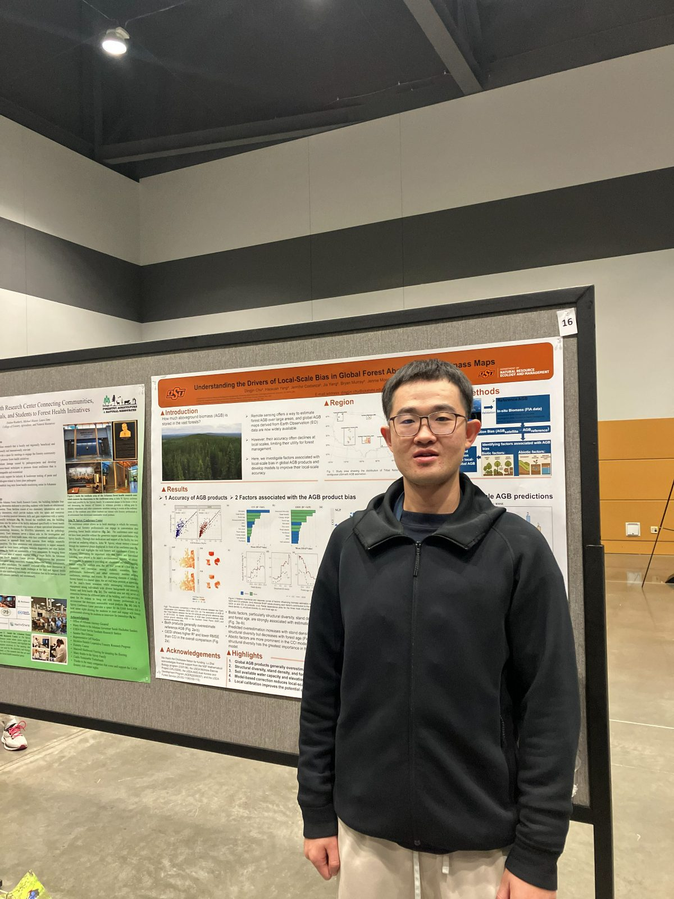
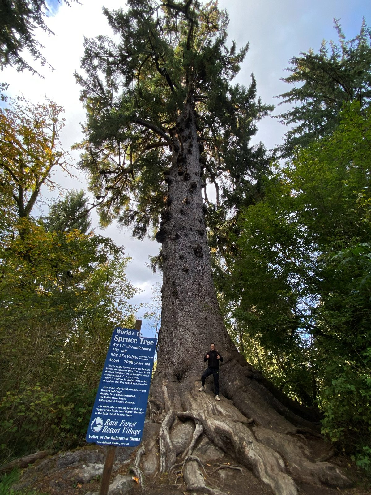
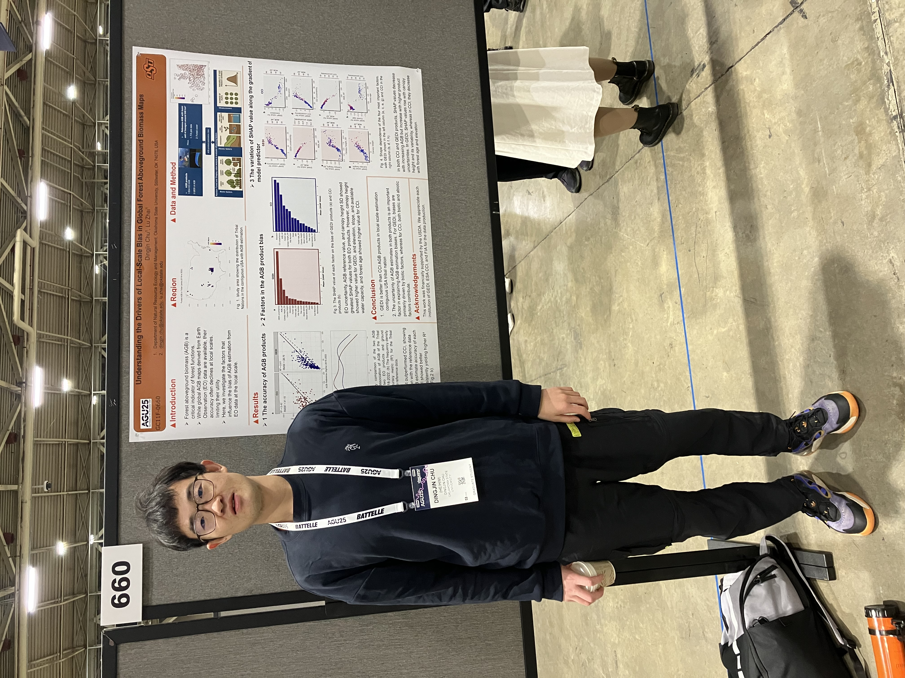
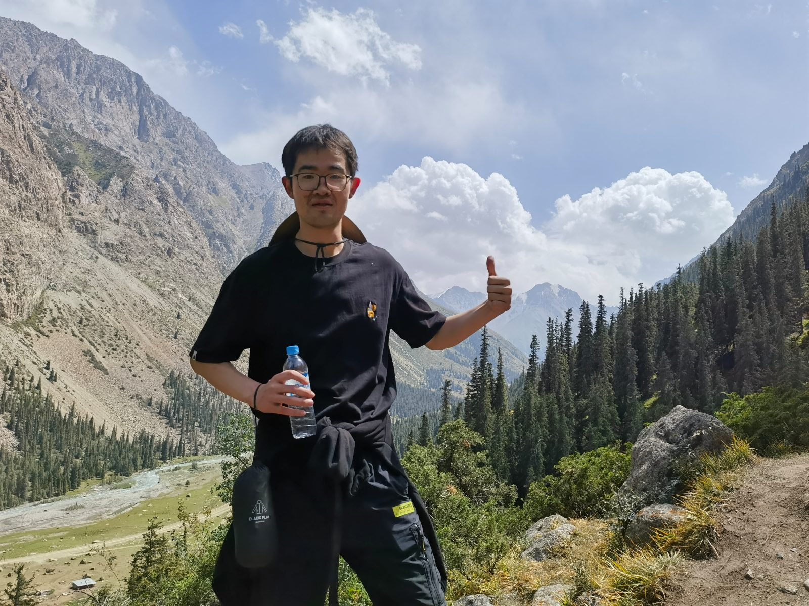

# 2026

7–8 Oct 2026

<h5><strong>SAF National Convention, Tacoma, Washington, USA</strong></h5>

Dingjin presented two studies at the 2026 Society of American Foresters (SAF) National Convention:

<ul>
  <li><strong>Talk (30 min):</strong> <em>Patterns and Drivers of Urban Forest Cooling Across U.S. Cities</em></li>
  <li><strong>Poster:</strong> <em>Understanding the Drivers of Local-Scale Bias in Global Forest Aboveground Biomass Maps</em></li>
</ul>

  

  

<small class="text-muted">Left: with the poster in the Expo Hall. Right: after the convention, the world's largest Sitka spruce at Lake Quinault, Olympic Peninsula.</small>

<a href="https://safconvention2026.eventscribe.net/" class="btn btn-primary" target="_blank">Convention Program</a>
<a href="projects_urban.qmd" class="btn btn-outline-primary">About this research</a>

14 May 2026

<h5><strong>New Paper Published in <em>Environmental Research Letters</em></strong></h5>

Using CMIP6 projections, this study shows that intensifying climate extremes — droughts, heatwaves, and anomalous wet periods — will amplify the year-to-year swings in plant productivity across Central Asia's arid and semi-arid ecosystems, making carbon uptake increasingly unpredictable under future warming.

<small class="text-muted">Chu, D., Zhang, L., Wu, H., He, H., &amp; Ren, X. (2026). <em>Environmental Research Letters.</em> DOI: 10.1088/1748-9326/ae6dd4</small>

<a href="https://doi.org/10.1088/1748-9326/ae6dd4" class="btn btn-primary" target="_blank">Read Paper</a>

Apr 2026

<h5><strong>Talk at the Natural Resource Conference, Oklahoma City, USA</strong></h5>

Dingjin gave a talk on <em>The factors influencing the accuracy of global forest biomass maps to estimate local carbon storage: a case study of Tribal Nations in the U.S.</em>

<a href="projects_agb.qmd" class="btn btn-outline-primary">About this research</a>

# 2025

15–19 Dec 2025

<h5><strong>AGU Fall Meeting, New Orleans, USA</strong></h5>

Dingjin presented the poster <em>Understanding the Drivers of Local-Scale Bias in Global Forest Aboveground Biomass Maps</em> at the AGU Fall Meeting.

<a href="https://www.agu.org" class="btn btn-primary" target="_blank">Visit AGU</a>

# 2023

16–17 Aug 2023

  <h5><strong>Poster Presentation at the Conference “Actual Issues of Environmental Research for Sustainable Development in the Arid Zone” in Kyrgyzstan</strong></h5>
  
Poster about the impacts of future climate extremes on the interannual variability of terrestrial ecosystem productivity in Central Asia based on CMIP6.

  
  
<small class="text-muted">In the Tian Shan mountains, Kyrgyzstan, during the trip (Aug 2023).</small>

