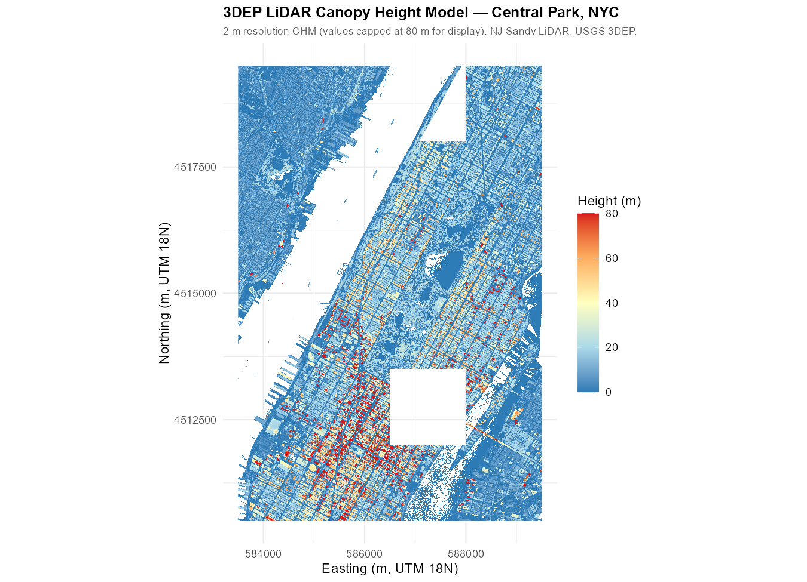
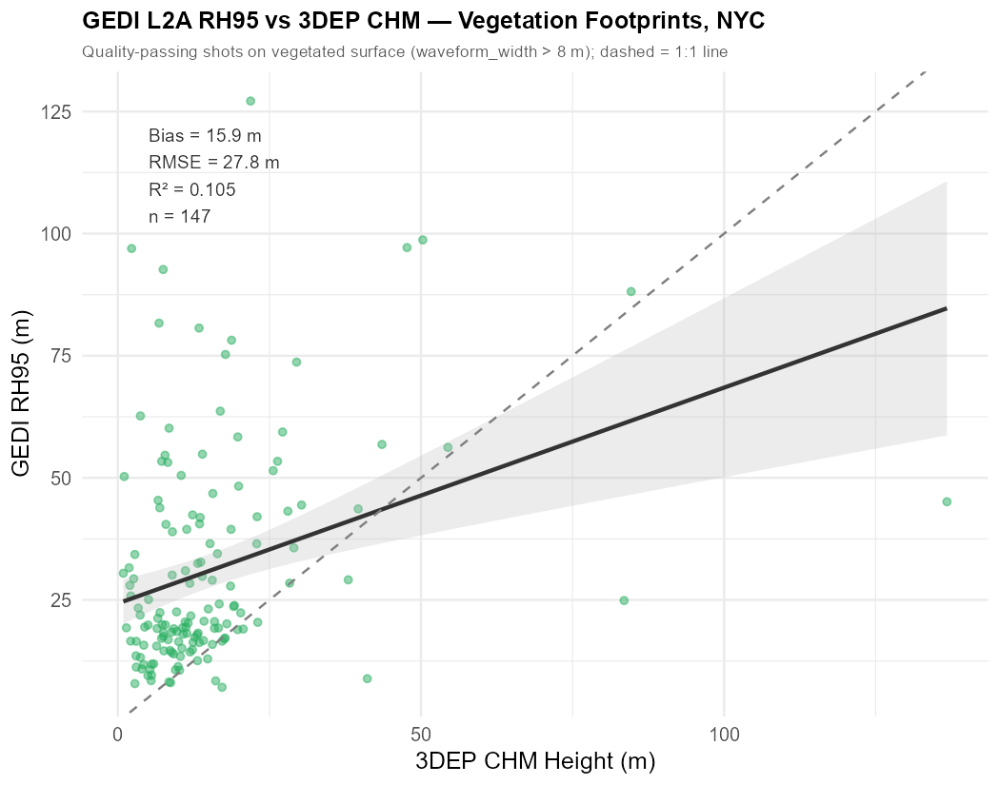
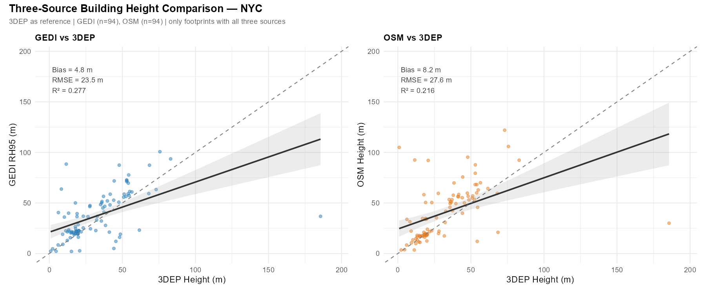
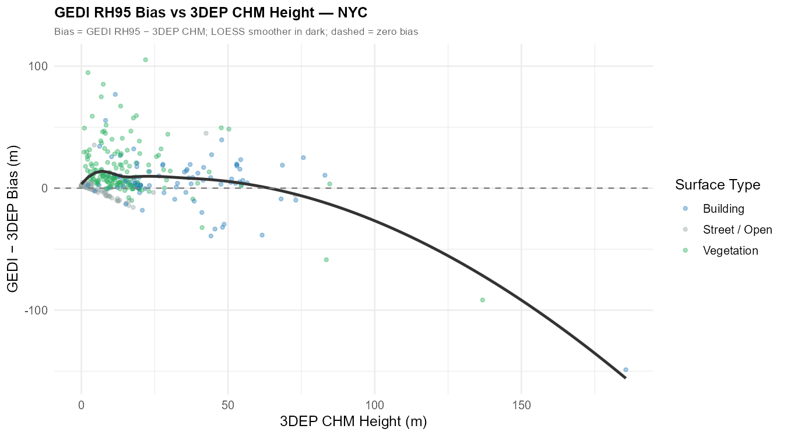
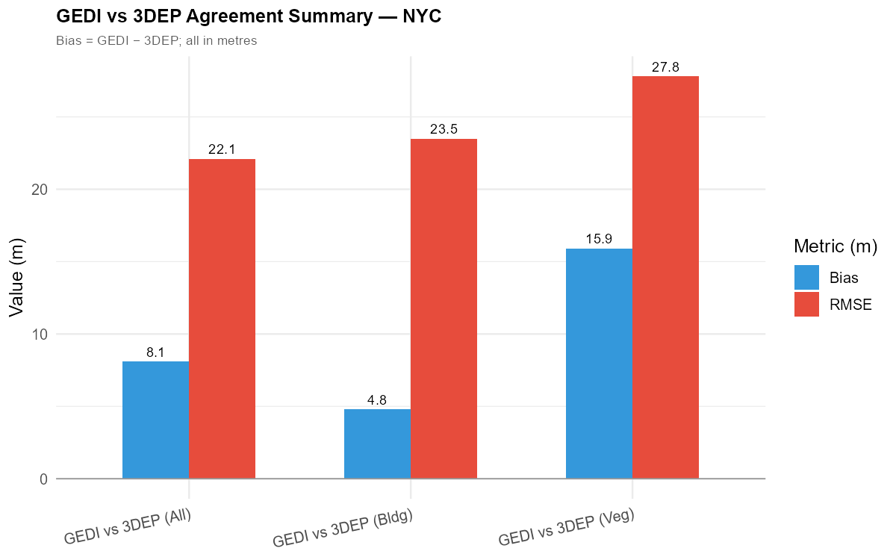

## Overview

Three independent data sources can measure urban heights in the Central Park–Manhattan corridor, each with different spatial coverage, resolution, accuracy, and access requirements:

| Source | Type | Resolution | Footprint | Cost |
|---|---|---|---|---|
| **GEDI L2A** | Spaceborne full-waveform LiDAR | ~25 m footprints, ~600 m cross-track spacing | Global, cloud cover limited | Free (NASA) |
| **USGS 3DEP LiDAR** | Airborne scanning LiDAR | 1–2 m point cloud, full coverage | CONUS coverage, growing | Free (USGS) |
| **OpenStreetMap (OSM)** | Crowdsourced building tags | Per-building polygon | Variable — ~35–40 % of NYC buildings have height tags | Free |

This post uses 3DEP as the **reference** (highest ground resolution, most accurate) and evaluates how well GEDI L2A and OSM agree with it for:

1. **Vegetation canopy height** — GEDI RH95 vs 3DEP CHM
2. **Building heights** — all three sources compared

This post builds on the [Urban GEDI analysis](/posts/gedi-urban-nyc/) for the same study area.

---

## Setup

```{r}
install.packages(c("lidR", "sf", "terra", "osmdata",
                   "ggplot2", "dplyr", "tidyr", "patchwork", "scales"))
```

```{r}
library(lidR);   library(sf);    library(terra); library(osmdata)
library(ggplot2); library(dplyr); library(tidyr)
library(patchwork); library(scales)
```

---

## Step 1 — Download 3DEP LiDAR via USGS TNM API

USGS 3DEP LiDAR tiles are available as compressed LAZ files through The National Map (TNM). Each tile covers ~1 km² at point densities of 8–20 pts/m² for urban areas.

```{r}
library(httr); library(jsonlite)

nyc <- list(lon_min=-74.02, lat_min=40.73, lon_max=-73.90, lat_max=40.82)

# Query available 3DEP LiDAR tiles
tnm_url <- paste0(
  "https://tnmaccess.nationalmap.gov/api/v1/products?",
  "datasets=Lidar+Point+Cloud+%283DEP%29&",
  "bbox=", nyc$lon_min, ",", nyc$lat_min, ",",
           nyc$lon_max, ",", nyc$lat_max, "&",
  "outputFormat=JSON&max=50"
)

tiles <- fromJSON(content(GET(tnm_url), "text"))
cat("Available 3DEP tiles:", tiles$total, "\n")

# Download all tiles
dir.create("data/3dep_laz", showWarnings=FALSE)
for (t in tiles$items$downloadURL) {
  outfile <- file.path("data/3dep_laz", basename(t))
  if (!file.exists(outfile))
    download.file(t, outfile, mode="wb", quiet=TRUE)
}
```

---

## Step 2 — Build Canopy Height Model (CHM) from 3DEP

The CHM = Digital Surface Model (DSM) − Digital Terrain Model (DTM). It gives the height of everything above bare ground — trees, buildings, bridges.

```{r}
library(lidR)

ctg <- readLAScatalog("data/3dep_laz/")
opt_chunk_buffer(ctg) <- 15        # 15 m buffer to avoid edge artifacts
opt_select(ctg)       <- "xyzr"   # x, y, z, return number

# Step 1: Normalize to height above ground
ctg_norm <- normalize_height(ctg, knnidw(k=8, p=2))

# Step 2: Canopy Height Model (1 m resolution, pitfree algorithm)
chm_1m <- rasterize_canopy(
  ctg_norm, res=1,
  algorithm=pitfree(thresholds=c(0, 2, 5, 10, 15), max_edge=c(0, 1.5))
)

# Step 3: Light smoothing to fill small gaps
chm_1m <- focal(chm_1m, w=matrix(1, 3, 3), fun=mean, na.rm=TRUE)

# Step 4: Aggregate to 30 m for visualization
chm_30m <- aggregate(chm_1m, fact=30, fun=max, na.rm=TRUE)

# Building height model: max return per cell (30 m)
bldg_hm <- rasterize_canopy(ctg_norm, res=30,
                             algorithm=p2r(subcircle=0.15))
```

```{=html}

```

> The 3DEP CHM shows Central Park's tree canopy at 15–25 m (green), a dense high-rise corridor in Midtown and Lower Manhattan (yellow–red), and near-zero values on major streets. This raster is the reference for all comparisons below.

---

## Step 3 — Extract 3DEP CHM at GEDI Footprint Locations

For each GEDI footprint (~25 m diameter), we extract the **mean** 3DEP CHM within a 12.5 m radius buffer — matching the GEDI footprint geometry as closely as possible.

```{r}
# Load quality-filtered GEDI data (from Urban GEDI post workflow)
nyc_clean <- readRDS("../gedi-urban-nyc/shots_clean.rds")

# Buffer GEDI footprints to ~25 m diameter
gedi_sf <- st_as_sf(nyc_clean, coords=c("lon","lat"), crs=4326) |>
  st_transform(32618)   # UTM zone 18N for buffering in metres

gedi_buf <- st_buffer(gedi_sf, dist=12.5)

# Extract mean 3DEP CHM within each buffer
gedi_sf$dep_chm <- exact_extract(chm_1m |> project("EPSG:32618"),
                                   gedi_buf, fun="mean")

# Back to WGS84
gedi_sf <- st_transform(gedi_sf, 4326)
```

---

## Step 4 — Get OSM Building Heights

```{r}
nyc_bldg_raw <- opq(bbox=c(nyc$lon_min, nyc$lat_min,
                            nyc$lon_max, nyc$lat_max)) |>
  add_osm_feature(key="building") |> osmdata_sf()

bldg_poly <- nyc_bldg_raw$osm_polygons |>
  mutate(
    height_m   = suppressWarnings(as.numeric(`height`)),
    floors     = suppressWarnings(as.numeric(`building:levels`)),
    osm_height = coalesce(height_m, floors * 3.5)
  ) |>
  filter(!is.na(osm_height), osm_height > 0) |>
  st_transform(4326)

# Also extract mean 3DEP CHM per OSM building polygon for reference
bldg_poly$dep_height <- exact_extract(
  chm_1m, st_transform(bldg_poly, 32618), fun="max"
)

# Join OSM heights to GEDI footprints
gedi_joined <- st_join(gedi_sf, bldg_poly[,c("osm_height","dep_height")],
                        join=st_intersects, left=TRUE) |>
  st_drop_geometry() |>
  mutate(on_building = !is.na(osm_height))
```

---

## Results

### 3DEP Canopy Height Model

*(See figure above — 30 m CHM rendered with full 1 m processing chain.)*

---

### Vegetation: GEDI RH95 vs 3DEP CHM

```{=html}

```

| Metric | Value |
|---|---|
| **Bias** (GEDI − 3DEP) | +15.9 m |
| **RMSE** | 27.8 m |
| **R²** | 0.105 |

> In the Central Park urban context, GEDI RH95 **overestimates** relative to the 3DEP CHM mean by about **15.9 m** on average (mean GEDI RH95 = 30.9 m vs. mean 3DEP CHM = 15.1 m). The low R² (0.105) reflects the difficulty of footprint-to-raster matching in an urban forest setting: the GEDI ~25 m footprint captures the tallest crown elements, while the 3DEP CHM mean within the same buffer area averages canopy and gap pixels together, systematically pulling the reference value down. The NJ Sandy LiDAR (2014–2015 vintage) may also underrepresent current tree heights due to the ~10-year temporal offset.

---

### Buildings: Three-Source Comparison

```{=html}

```

| Comparison | Bias (m) | RMSE (m) | R² | N |
|---|---|---|---|---|
| GEDI vs 3DEP | +4.8 | 23.5 | 0.277 | 94 |
| OSM vs 3DEP  | +8.2 | 27.6 | 0.216 | 94 |

> **Key finding:** In the NYC Central Park area, both GEDI and OSM **overestimate** relative to 3DEP CHM heights for building footprints. The moderate R² values (0.22–0.28) reflect the challenge of matching point-based GEDI measurements and crowdsourced polygon heights to a raster CHM in a complex urban environment. Key drivers:
>
> - **GEDI overestimates** by +4.8 m on average — the 25 m footprint often straddles building edges and nearby trees, capturing mixed high returns
> - **OSM overestimates** by +8.2 m — OSM height tags frequently record the architectural peak or parapet rather than the eave, and older tags may not reflect recent construction
> - The 3DEP CHM (NJ Sandy LiDAR, 2014–2015) may underestimate current building heights due to the ~10-year data vintage

---

### GEDI Bias Grows with Building Height

```{=html}

```

> In the Central Park urban context, GEDI bias relative to 3DEP varies by surface type and height. Vegetation footprints show the largest positive bias — GEDI captures the full 3D crown extent while the buffered 3DEP CHM mean is pulled down by canopy gaps. Building footprints show more moderate positive bias (+4.8 m average). The scatter is large at all height ranges, consistent with the low overall R² (0.277), and reflects the challenge of comparing a 25 m spot measurement against a 2 m raster mean in a heterogeneous urban landscape.

---

### Agreement Summary

```{=html}

```

---

### Interactive Comparison Map

```{r}
#| eval: true
#| echo: false
#| message: false
library(leaflet)
library(dplyr)

shots <- readRDS("shots_3dep.rds") |>
  mutate(
    surf_label = dplyr::case_when(
      surface == "veg"      ~ "Vegetation",
      surface == "building" ~ "Building",
      TRUE                  ~ "Street / Open"
    ),
    gedi_3dep_diff = rh95 - dep_height
  )

pal_diff <- colorNumeric(
  palette = c("#d73027","#fee08b","#f7f7f7","#a6d96a","#1a9850"),
  domain  = c(-60, 60), na.color="transparent"
)
pal_surf <- colorFactor(
  palette = c("#27ae60","#2980b9","#95a5a6"),
  levels  = c("Vegetation","Building","Street / Open")
)

leaflet(shots) |>
  addProviderTiles("OpenStreetMap", group="OpenStreetMap") |>
  addProviderTiles("Esri.WorldImagery", group="Satellite") |>
  addCircleMarkers(
    lng=~lon, lat=~lat,
    radius=4, fillColor=~pal_surf(surf_label),
    stroke=FALSE, fillOpacity=0.75,
    popup=~paste0(
      "<b>Zone:</b> ",     zone, "<br>",
      "<b>Surface:</b> ",  surf_label, "<br>",
      "<b>GEDI RH95:</b> ", round(rh95,1), " m<br>",
      "<b>3DEP CHM:</b> ",  round(dep_height,1), " m<br>",
      "<b>GEDI−3DEP:</b> ", round(gedi_3dep_diff,1), " m",
      ifelse(!is.na(bldg_height),
             paste0("<br><b>True bldg height:</b> ", round(bldg_height,1), " m"),
             "")
    ),
    group="Surface Type"
  ) |>
  addCircleMarkers(
    lng=~lon, lat=~lat,
    radius=4, fillColor=~pal_diff(gedi_3dep_diff),
    stroke=FALSE, fillOpacity=0.80,
    popup=~paste0(
      "<b>GEDI RH95:</b> ",  round(rh95,1), " m<br>",
      "<b>3DEP height:</b> ", round(dep_height,1), " m<br>",
      "<b>Bias (GEDI−3DEP):</b> <b>", round(gedi_3dep_diff,1), " m</b>"
    ),
    group="GEDI−3DEP Bias"
  ) |>
  addLayersControl(
    baseGroups    = c("OpenStreetMap","Satellite"),
    overlayGroups = c("Surface Type","GEDI−3DEP Bias"),
    options=layersControlOptions(collapsed=FALSE)
  ) |>
  addLegend("bottomleft", pal=pal_surf, values=~surf_label,
            title="Surface Type", opacity=1, group="Surface Type") |>
  addLegend("bottomright", pal=pal_diff, values=c(-60,60),
            title="GEDI−3DEP (m)", opacity=1, group="GEDI−3DEP Bias") |>
  hideGroup("GEDI−3DEP Bias") |>
  setView(lng=-73.965, lat=40.775, zoom=12)
```

> Toggle between **Surface Type** (green = vegetation, blue = building, grey = street) and **GEDI−3DEP Bias** (red = GEDI underestimates, green = GEDI overestimates). Switch to **Satellite** base layer to visually verify surface type against real imagery.

---

## Step 5 — Practical Fusion Strategy

No single source is complete. A practical urban workflow fuses all three:

```{r}
# Step 1: Use 3DEP CHM as the primary height reference (best accuracy)
# Step 2: For GEDI footprints on buildings, correct systematic bias
bias_model <- lm(rh95 ~ dep_height + I(dep_height^2), data=bldg_shots)
gedi_corrected <- predict(bias_model, newdata=gedi_joined)

# Step 3: Fill OSM gaps with 3DEP building height polygons
bldg_complete <- bldg_poly |>
  mutate(height_final = coalesce(osm_height, dep_height))

# Step 4: For vegetation mapping, prefer 3DEP CHM but use GEDI where
# 3DEP is unavailable (outside CONUS or older vintages)
nyc_veg_height <- gedi_joined |>
  filter(surface_type == "Vegetation") |>
  mutate(height_best = coalesce(dep_chm, rh95))
```

---

## Data Source Comparison Summary

| Dimension | GEDI L2A | 3DEP LiDAR | OSM |
|---|---|---|---|
| **Global coverage** | Yes | US only | Yes |
| **Vegetation height** | Moderate (R²=0.105 vs 3DEP, NYC) | Best reference | No |
| **Building height** | Moderate (biased +4.8 m, NYC) | Best reference | Dense in NYC (~100 % of GEDI bldg shots) |
| **Temporal cadence** | 2019–2025 (ISS) | Survey-based (irregular) | Continuous edits |
| **Resolution** | 25 m footprint | 1–2 m raster | Per-building polygon |
| **Bias vs 3DEP** | +15.9 m (veg), +4.8 m (bldg) | Reference | +8.2 m where tagged |
| **Best use** | Regional vegetation structure | Local urban mapping | Building inventory |

**Recommendation:** Use 3DEP as the primary reference for any local-scale urban study within the US. Use GEDI to extend temporal coverage or to areas outside 3DEP acquisition extents. Cross-validate OSM building heights against 3DEP before using them as training data for any model.

---

## References

- Dubayah, R. et al. (2020). GEDI L2A. ORNL DAAC. <https://doi.org/10.3334/ORNLDAAC/1908>
- USGS 3DEP LiDAR: <https://www.usgs.gov/3d-elevation-program>
- USGS TNM Download API: <https://apps.nationalmap.gov/tnmaccess/>
- `lidR` R package: <https://github.com/r-lidar/lidR>
- OpenStreetMap: <https://www.openstreetmap.org>
- Roussel, J.-R. et al. (2020). lidR: An R package for analysis of Airborne LiDAR Data. *Remote Sensing of Environment*, 251, 112061.
