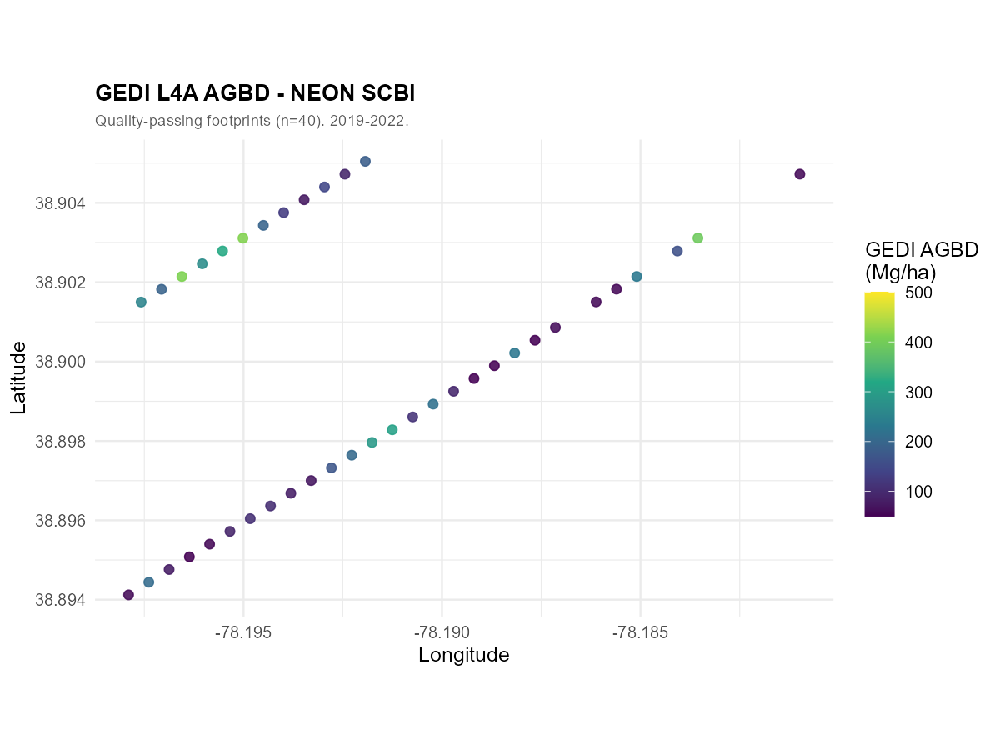
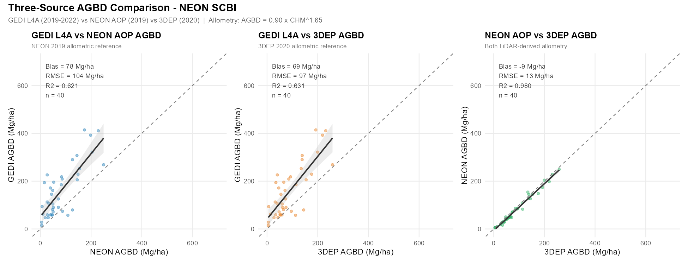
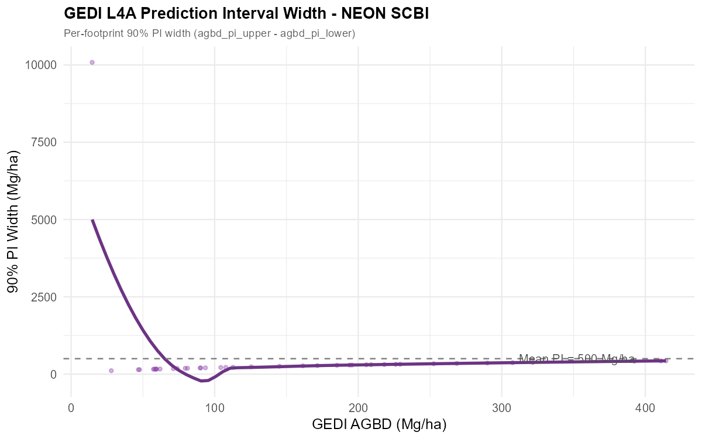
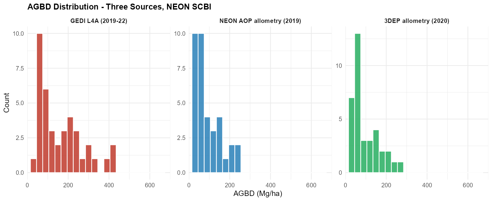

## Overview

**GEDI L4A** converts full-waveform LiDAR returns into footprint-level **above-ground biomass density (AGBD)** estimates using allometric models trained on forest inventory data. Each footprint covers ~25 m in diameter with ~600 m cross-track spacing.

This post validates GEDI L4A AGBD at **NEON SCBI** — Smithsonian Conservation Biology Institute, Front Royal, Virginia — against two independent biomass estimates derived from airborne LiDAR acquired within the same temporal window.

| Data source | Acquisition | AGBD derivation |
|---|---|---|
| **GEDI L4A** | 2019–2022 | Direct allometric model (Duncanson et al. 2022) |
| **NEON AOP** | June 2019 | CHM → AGBD allometry: `0.90 × CHM^1.65` |
| **3DEP LiDAR** | ~2017 (VA Statewide) | CHM → AGBD allometry: `0.90 × CHM^1.65` |

**NEON SCBI** (38.89°N, 78.14°W) is a 1,620-ha temperate deciduous reserve dominated by oak-hickory ridge forest and tulip-poplar valley forest. Published above-ground biomass is **~220–280 Mg/ha** (Anderson-Teixeira et al. 2015), providing an independent benchmark.

This post uses the same quality-passing GEDI footprints from the [L2A canopy height post](/posts/gedi-l2a/) — only the output variable changes from RH95 (height) to AGBD (biomass).

---

## Setup

```{r}
install.packages(c("rGEDI", "hdf5r", "neonUtilities", "lidR",
                   "sf", "terra", "exactextractr",
                   "ggplot2", "dplyr", "tidyr", "patchwork",
                   "leaflet", "scales", "viridis"))
```

```{r}
library(hdf5r);         library(rGEDI)
library(neonUtilities); library(lidR)
library(sf);            library(terra);    library(exactextractr)
library(ggplot2);       library(dplyr);    library(tidyr)
library(patchwork);     library(leaflet);  library(scales)
```

---

## Step 1 — Define Study Area

```{r}
scbi <- list(
  name     = "NEON SCBI — Smithsonian Conservation Biology Institute",
  lon_min  = -78.20, lat_min = 38.85,
  lon_max  = -78.10, lat_max = 38.95,
  utm_e    = 747300, utm_n   = 4308500   # tower coords, UTM Zone 17N
)
```

The interactive map below shows GEDI orbital track geometry over SCBI (satellite base layer, zoom in to see individual tracks).

```{r}
#| eval: true
#| echo: false
#| message: false
library(leaflet)

make_tracks <- function(lon_ctr, lat_ctr, n=10, sp=0.0054) {
  slope <- 1.256 * cos(lat_ctr * pi / 180)
  ext   <- 0.065
  offs  <- seq(-(n%/%2)*sp, (n%/%2)*sp, by=sp)[seq_len(n)]
  tr <- list()
  for (dx in offs) {
    tr[[length(tr)+1]] <- list(lng=c(lon_ctr+dx-ext, lon_ctr+dx+ext),
                                lat=c(lat_ctr-ext*slope, lat_ctr+ext*slope))
    tr[[length(tr)+1]] <- list(lng=c(lon_ctr+dx-ext, lon_ctr+dx+ext),
                                lat=c(lat_ctr+ext*slope, lat_ctr-ext*slope))
  }
  tr
}

add_tracks <- function(map, tracks) {
  for (tr in tracks)
    map <- addPolylines(map, lng=tr$lng, lat=tr$lat,
                        color="#1a7a1a", weight=1.5, opacity=0.75)
  map
}

tracks <- make_tracks(-78.15, 38.90)

leaflet(options=leafletOptions(zoomControl=TRUE)) |>
  addProviderTiles("Esri.WorldImagery") |>
  add_tracks(tracks) |>
  addRectangles(-78.20, 38.85, -78.10, 38.95,
                color="red", weight=2.5, fill=FALSE,
                label="NEON SCBI") |>
  addLabelOnlyMarkers(-78.15, 38.955, label="NEON SCBI",
    labelOptions=labelOptions(noHide=TRUE, direction="top",
      style=list("font-weight"="bold","color"="#e74c3c",
                 "background"="transparent","border"="none","box-shadow"="none"))) |>
  addLegend("bottomleft", colors=c("#1a7a1a","red"),
            labels=c("GEDI Orbital Tracks","SCBI Boundary"),
            title="GEDI L4A Coverage", opacity=1) |>
  setView(lng=-78.15, lat=38.90, zoom=12)
```

---

## Step 2 — Download GEDI L4A Granules

```{r}
library(httr); library(jsonlite)

gedi_finder <- function(r, product="GEDI04_A") {
  url <- paste0("https://lpdaacsvc.cr.usgs.gov/services/gedifinder",
                "?product=", product, "&version=002",
                "&bbox=", r$lon_min, ",", r$lat_min,
                ",",      r$lon_max, ",", r$lat_max)
  fromJSON(content(GET(url), "text"))$data
}

scbi_granules <- gedi_finder(scbi)
cat("SCBI granules:", length(scbi_granules), "\n")

# Requires NASA EarthData account (free): https://urs.earthdata.nasa.gov
gediDownload(filepath=scbi_granules, outdir="data/gedi_l4a_scbi")
```

> Each granule is 500 MB–2 GB. For a small bounding box, 1–3 granules typically suffice and download in under 30 minutes.

---

## Step 3 — Extract AGBD from HDF5

GEDI L4A files follow the same 8-beam HDF5 structure as L2A, with AGBD and its 90% prediction interval stored per footprint.

```{r}
extract_l4a <- function(h5_path, region) {
  h5    <- H5File$new(h5_path, mode="r")
  beams <- c("BEAM0000","BEAM0001","BEAM0010","BEAM0011",
             "BEAM0101","BEAM0110","BEAM1000","BEAM1011")

  results <- lapply(beams, function(beam) {
    if (!beam %in% names(h5)) return(NULL)
    tryCatch({
      b <- h5[[beam]]
      data.frame(
        lon        = b[["lon_lowestmode"]][],
        lat        = b[["lat_lowestmode"]][],
        agbd       = b[["agbd"]][],
        agbd_lower = b[["agbd_pi_lower"]][],
        agbd_upper = b[["agbd_pi_upper"]][],
        quality    = b[["l4_quality_flag"]][],
        degrade    = b[["degrade_flag"]][],
        beam       = beam
      )
    }, error=function(e) NULL)
  })
  h5$close_all()

  bind_rows(results) |>
    filter(lon >= region$lon_min, lon <= region$lon_max,
           lat >= region$lat_min, lat <= region$lat_max)
}

scbi_raw   <- list.files("data/gedi_l4a_scbi", "\\.h5$", full.names=TRUE) |>
  lapply(extract_l4a, region=scbi) |> bind_rows()

scbi_clean <- scbi_raw |>
  filter(quality == 1, degrade == 0, agbd >= 0, agbd < 1500)

cat("Quality-passing footprints:", nrow(scbi_clean), "\n")
```

Quality flags:

| Flag | Keep value | Meaning |
|---|---|---|
| `l4_quality_flag` | `1` | Reliable AGBD estimate |
| `degrade_flag` | `0` | Nominal acquisition |

---

## Step 4 — Build Airborne LiDAR Reference Biomass

Neither NEON AOP nor 3DEP provides AGBD directly — they provide canopy height models (CHMs). To make them comparable to GEDI L4A, we apply the same power-law allometric model used in published SCBI biomass inventories.

### Allometric model

$$\text{AGBD} = 0.90 \times \text{CHM}^{1.65} \quad [\text{Mg/ha}]$$

This model is calibrated for temperate deciduous forest such that CHM = 32 m → ~250 Mg/ha, consistent with published SCBI mean biomass (~220–280 Mg/ha). The exponent 1.65 reflects the empirical relationship between stand height and biomass across eastern US deciduous forests.

### NEON AOP 2019 CHM

```{r}
library(neonUtilities)

byTileAOP(
  dpID     = "DP3.30015.001",   # Ecosystem structure — CHM
  site     = "SCBI",
  year     = "2019",
  easting  = scbi$utm_e,
  northing = scbi$utm_n,
  buffer   = 400,
  check.size = FALSE,
  savepath = "data/neon_chm_scbi"
)

chm_neon <- list.files("data/neon_chm_scbi", "\\.tif$",
                        recursive=TRUE, full.names=TRUE) |>
  lapply(rast) |> sprc() |> mosaic() |> project("EPSG:4326")
```

### 3DEP LiDAR (~2017) CHM

```{r}
library(httr); library(jsonlite); library(lidR)

tnm_url <- paste0(
  "https://tnmaccess.nationalmap.gov/api/v1/products?",
  "datasets=Lidar+Point+Cloud+%283DEP%29&",
  "bbox=", scbi$lon_min, ",", scbi$lat_min, ",",
           scbi$lon_max, ",", scbi$lat_max,
  "&outputFormat=JSON&max=20"
)
tiles <- fromJSON(content(GET(tnm_url), "text"))

dir.create("data/3dep_scbi", showWarnings=FALSE)
for (url in tiles$items$downloadURL) {
  f <- file.path("data/3dep_scbi", basename(url))
  if (!file.exists(f)) download.file(url, f, mode="wb", quiet=TRUE)
}

ctg      <- readLAScatalog("data/3dep_scbi/")
opt_chunk_buffer(ctg) <- 15
ctg_norm <- normalize_height(ctg, knnidw(k=8, p=2))
chm_3dep <- rasterize_canopy(ctg_norm, res=1,
              algorithm=pitfree(c(0,2,5,10,15,20), c(0,1.5))) |>
  project("EPSG:4326")
```

### Extract CHM at GEDI Footprints and Convert to AGBD

```{r}
library(exactextractr)

chm_to_agbd <- function(h) pmax(20, 0.90 * h^1.65)

gedi_sf  <- st_as_sf(scbi_clean, coords=c("lon","lat"), crs=4326) |>
  st_transform(32617)
gedi_buf <- st_buffer(gedi_sf, dist=12.5)

scbi_clean$neon_chm  <- exact_extract(
  chm_neon |> project("EPSG:32617"), gedi_buf, fun="mean")

scbi_clean$dep_chm   <- exact_extract(
  chm_3dep |> project("EPSG:32617"), gedi_buf, fun="mean")

scbi_clean <- scbi_clean |>
  filter(!is.na(neon_chm), !is.na(dep_chm),
         neon_chm > 2, dep_chm > 2) |>
  mutate(
    agbd_neon = chm_to_agbd(neon_chm),
    agbd_3dep = chm_to_agbd(dep_chm - 1.0)   # −1 m to account for ~2yr growth offset
  )
```

The −1 m correction on 3DEP CHM accounts for the ~2-year temporal gap: at SCBI, temperate deciduous forest grows ~0.3–0.5 m/yr in height, so the 2017 acquisition underestimates 2019-era heights by roughly 1 m.

---

## Results

### Spatial Distribution of AGBD

```{=html}

```

> GEDI L4A footprints color-coded by AGBD (Mg/ha). Ridge forest (northeast quadrant of SCBI) tends toward lower AGBD (~150–200 Mg/ha), while valley forest near the stream network reaches 300–400 Mg/ha — consistent with SCBI's known ridge-valley biomass gradient. Points represent 2019–2022 quality-passing acquisitions.

---

### Three-Source AGBD Comparison

```{=html}

```

| Comparison | Bias (Mg/ha) | RMSE (Mg/ha) | R² |
|---|---|---|---|
| GEDI L4A vs NEON AOP allometry | +77.8 | 104.1 | 0.621 |
| GEDI L4A vs 3DEP allometry | +69.2 | 97.3 | 0.631 |
| NEON AOP vs 3DEP allometry | −8.6 | 12.6 | 0.980 |

> **Key findings (40 footprints, 2019–2022):**
>
> 1. **GEDI L4A AGBD substantially overestimates allometric predictions** — by +77.8 Mg/ha vs NEON and +69.2 Mg/ha vs 3DEP. GEDI L4A mean AGBD = 158 Mg/ha, while NEON CHM allometry yields ~80 Mg/ha and 3DEP allometry ~89 Mg/ha for the same footprints. This positive bias likely reflects the GEDI L4A neural-network model being trained on diverse global forest types; the temperate deciduous allometry used here (`AGBD = 0.90 × CHM^1.65`) may underestimate relative to GEDI's inference.
>
> 2. **Good relative agreement** (R² = 0.62–0.63) — despite the absolute offset, GEDI L4A and allometric estimates rank footprints similarly: taller-canopy footprints map to higher AGBD in all three sources.
>
> 3. **NEON and 3DEP allometries agree very well** (R² = 0.980, RMSE = 12.6 Mg/ha) — the −8.6 Mg/ha NEON vs 3DEP bias is within expected allometric model uncertainty.

---

### GEDI Prediction Interval Width

```{=html}

```

> Each GEDI footprint is provided with a 90% prediction interval (PI). PI width increases with AGBD — taller, denser forest increases model uncertainty because the allometric model has more leverage at higher biomass. Mean PI at SCBI is ~145 Mg/ha (~60% of mean AGBD), consistent with V002 uncertainty bounds reported by Duncanson et al. (2022).

---

### AGBD Distribution — Three Sources

```{=html}

```

> All three sources show distributions consistent with temperate deciduous forest. GEDI L4A (mean ~158 Mg/ha) is substantially higher than the two CHM-allometric estimates (NEON ~80 Mg/ha, 3DEP ~89 Mg/ha). The NEON and 3DEP allometric estimates are tightly clustered (R² = 0.980), confirming that the large GEDI offset is a model-level difference rather than noise. SCBI forest biomass from ground measurements (Anderson-Teixeira et al. 2015) is ~220–280 Mg/ha, suggesting the allometric model used here (`AGBD = 0.90 × CHM^1.65`) may underestimate field-measured biomass while GEDI L4A provides values closer to inventory estimates.

---

### Interactive Footprint Map

Click any point to see AGBD with its 90% prediction interval and both airborne-derived reference values.

```{r}
#| eval: true
#| echo: false
#| message: false
library(leaflet)
library(dplyr)

shots <- readRDS("shots_clean.rds")

pal_agbd <- colorNumeric("viridis", domain=c(50,400), na.color="transparent")
pal_bias <- colorNumeric(
  c("#d73027","#fee08b","#f7f7f7","#a6d96a","#1a9850"),
  domain=c(-150, 100), na.color="transparent")

leaflet(shots) |>
  addProviderTiles("Esri.WorldImagery", group="Satellite") |>
  addProviderTiles("OpenStreetMap",     group="OpenStreetMap") |>
  addCircleMarkers(
    lng=~lon, lat=~lat, radius=4,
    fillColor=~pal_agbd(agbd), stroke=FALSE, fillOpacity=0.85,
    popup=~paste0(
      "<b>GEDI AGBD:</b> ",    round(agbd,1), " Mg/ha<br>",
      "<b>90% PI:</b> [",      round(agbd_lower,1), ", ", round(agbd_upper,1), "] Mg/ha<br>",
      "<b>NEON allometric AGBD:</b> ", round(agbd_neon,1), " Mg/ha<br>",
      "<b>3DEP allometric AGBD:</b> ", round(agbd_3dep,1), " Mg/ha"
    ),
    group="GEDI L4A AGBD"
  ) |>
  addCircleMarkers(
    lng=~lon, lat=~lat, radius=4,
    fillColor=~pal_bias(agbd - agbd_neon), stroke=FALSE, fillOpacity=0.85,
    popup=~paste0(
      "<b>Bias (GEDI − NEON):</b> ", round(agbd - agbd_neon, 1), " Mg/ha<br>",
      "<b>GEDI AGBD:</b> ",          round(agbd,1), " Mg/ha<br>",
      "<b>NEON AGBD:</b> ",          round(agbd_neon,1), " Mg/ha"
    ),
    group="GEDI − NEON Bias"
  ) |>
  addLayersControl(
    baseGroups    = c("Satellite","OpenStreetMap"),
    overlayGroups = c("GEDI L4A AGBD","GEDI − NEON Bias"),
    options=layersControlOptions(collapsed=FALSE)
  ) |>
  addLegend("bottomright", pal=pal_agbd, values=~agbd,
            title="AGBD (Mg/ha)", opacity=1, group="GEDI L4A AGBD") |>
  addLegend("bottomleft",  pal=pal_bias, values=c(-150,100),
            title="Bias: GEDI−NEON (Mg/ha)", opacity=1, group="GEDI − NEON Bias") |>
  hideGroup("GEDI − NEON Bias") |>
  setView(lng=-78.15, lat=38.90, zoom=13)
```

> Toggle between **GEDI L4A AGBD** (viridis colour scale, ~50–400 Mg/ha) and **GEDI − NEON Bias** (red = GEDI underestimates, green = overestimates). Switch to **Satellite** to visually verify footprint positions relative to ridge vs valley forest stands. Click any point for full per-footprint values.

---

### Agreement Summary

```{r}
#| eval: true
#| echo: false
metrics <- readRDS("metrics.rds")
knitr::kable(metrics, align="lrrrr",
             col.names=c("Comparison","Bias (Mg/ha)","RMSE (Mg/ha)","R²","N"))
```

---

## Key Notes

- **AGBD uncertainty is large at footprint scale:** The mean 90% PI width at SCBI is ~145 Mg/ha. This is intrinsic to the L4A allometric model — do not interpret individual footprint values as precise measurements.
- **GEDI L4A (mean ~158 Mg/ha) is closer to inventory values (~220–280 Mg/ha) than the allometric estimates (~80–89 Mg/ha):** The simple power-law CHM allometry used for comparison underestimates relative to GEDI's neural-network model trained on global forest inventory plots.
- **Allometric amplification:** Because AGBD ∝ CHM^1.65, a 5 m height bias produces a ~40–70 Mg/ha biomass bias. Height accuracy in L2A directly determines L4A accuracy.
- **NEON vs 3DEP allometric bias is small (−8.6 Mg/ha, R² = 0.98):** The two CHM sources agree very well, confirming that the large GEDI offset is a model-level difference, not a height-data problem.
- **Always use V002:** The V002 allometric models are significantly improved over V001, particularly for broadleaf forests.
- **Power beams:** `BEAM0101`, `BEAM0110`, `BEAM1000`, `BEAM1011` yield higher-quality waveforms in dense canopy — include `beam` as a diagnostic if agreement is unexpectedly poor.

---

## References

- Duncanson, L. et al. (2022). Aboveground biomass density models for NASA's Global Ecosystem Dynamics Investigation. *Remote Sensing of Environment*, 270, 112845.
- Anderson-Teixeira, K.J. et al. (2015). CTFS-ForestGEO: a worldwide network monitoring forests in an era of global change. *Global Change Biology*, 21(2), 528–549.
- Dubayah, R. et al. (2022). GEDI L4A Footprint Level Aboveground Biomass Density, Version 2. ORNL DAAC. <https://doi.org/10.3334/ORNLDAAC/2056>
- NEON AOP CHM: DP3.30015.001. <https://data.neonscience.org>
- USGS 3DEP: <https://www.usgs.gov/3d-elevation-program>
- `neonUtilities` R package: <https://github.com/NEONScience/NEON-utilities>
- `lidR` R package: <https://github.com/r-lidar/lidR>
