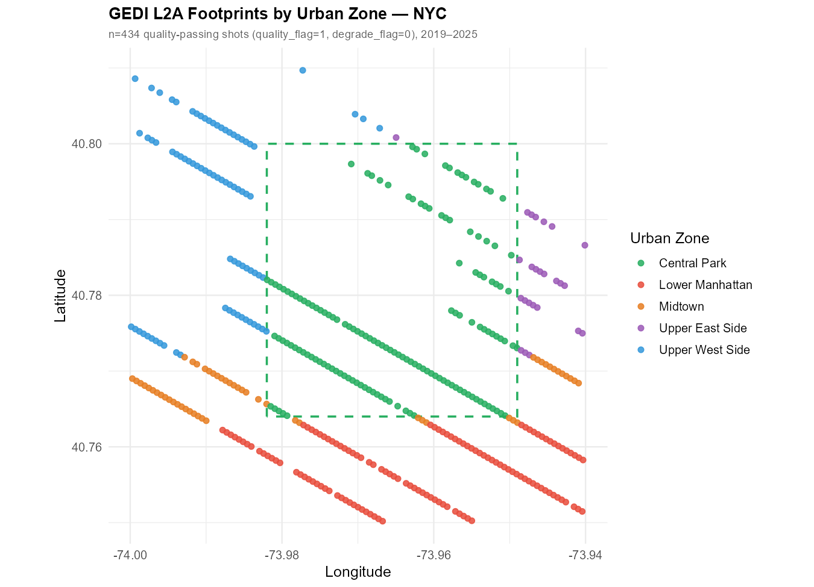
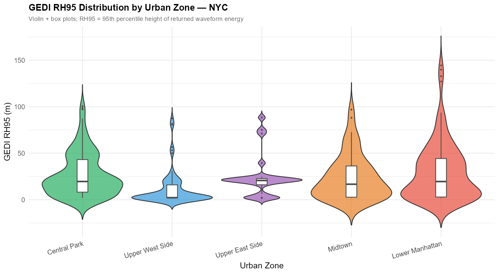
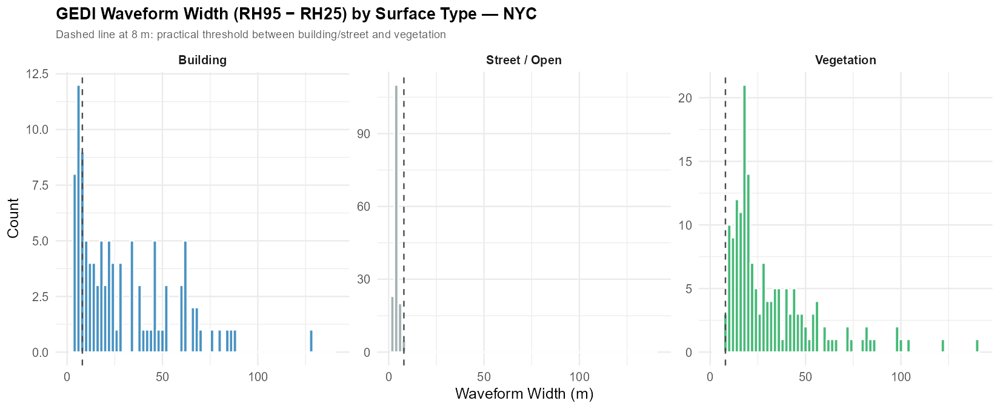
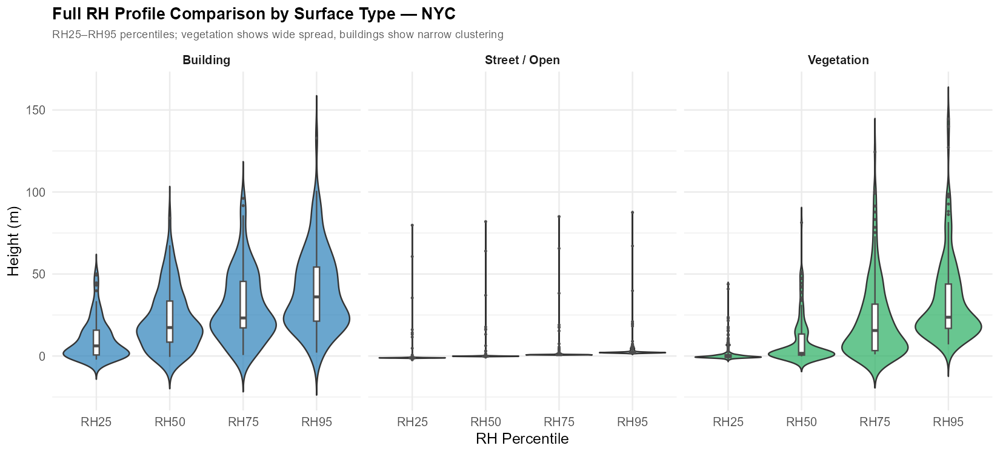
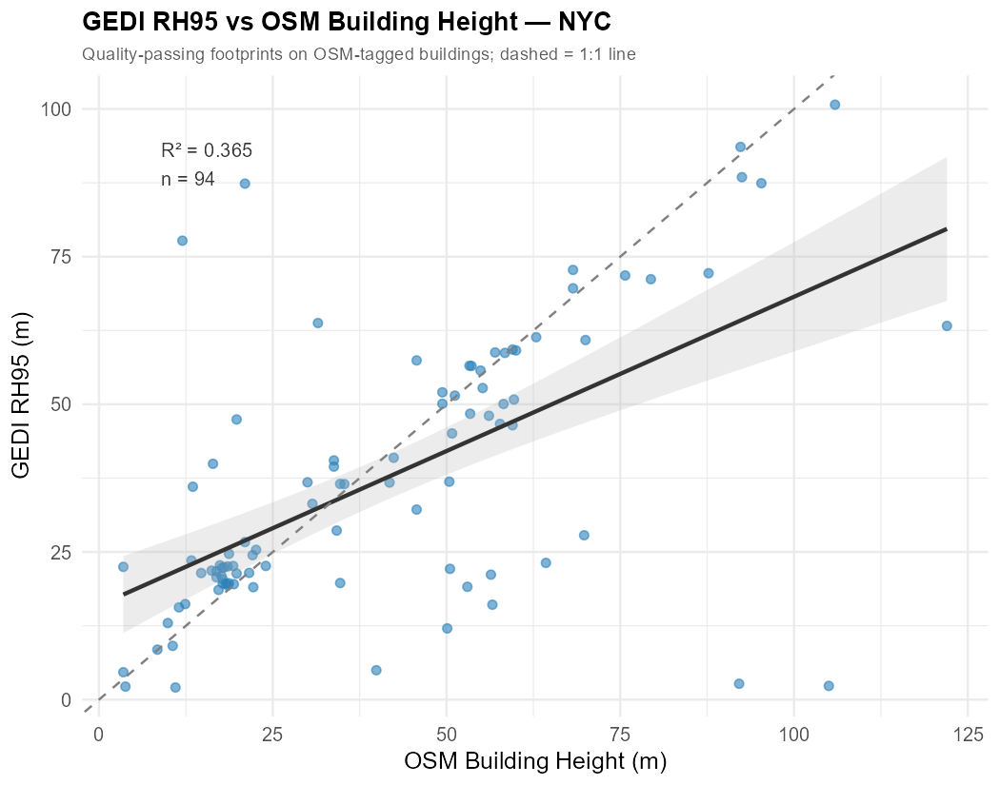
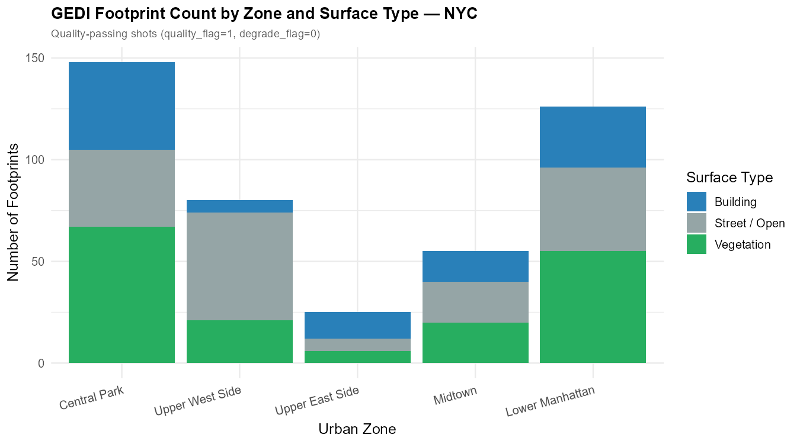

## Overview

GEDI L2A measures the **vertical distribution of returned laser energy** — but in urban areas the sensor cannot distinguish a 20 m tree from a 20 m rooftop. Both produce similar waveform returns. This post focuses exclusively on the **Central Park–Manhattan corridor** to explore:

| Question | What we measure |
|---|---|
| How well does GEDI detect park trees? | RH95 vs field-reference canopy heights |
| How does building height affect RH metrics? | RH95 vs OSM building heights |
| Can we tell buildings apart from trees? | Waveform width (RH95 − RH25) as a diagnostic |
| How much data survives quality filtering? | Quality flag pass rate by surface type |

**Study zones** (6 urban zones, same 0.12° × 0.09° footprint):

| Zone | Dominant surface | Expected GEDI signal |
|---|---|---|
| Central Park | Deciduous trees 15–25 m | Broad waveform, high RH95 |
| Upper West / East Side | Brownstones + apartment blocks 10–30 m | Narrow waveform, moderate RH95 |
| Midtown | Mixed low-commercial + high-rise 5–300 m | Wide RH95 spread, many failures |
| Lower Manhattan | Dense high-rise 10–400 m | High RH95, high quality-fail rate |
| North Manhattan | Residential 8–25 m | Low RH95, moderate pass rate |

---

## Setup

```{r}
install.packages(c("rGEDI","hdf5r","sf","osmdata",
                   "ggplot2","dplyr","tidyr",
                   "leaflet","viridis","patchwork","scales"))
```

```{r}
library(hdf5r); library(sf);       library(osmdata)
library(ggplot2); library(dplyr);  library(tidyr)
library(leaflet); library(viridis); library(patchwork); library(scales)
```

---

## Step 1 — Define Study Area

```{r}
nyc <- list(
  lon_min = -74.02, lat_min = 40.73,
  lon_max = -73.90, lat_max = 40.82
)

# Approximate Central Park boundary for zone labeling
cp_bounds <- list(
  lon_min = -73.981, lon_max = -73.949,
  lat_min =  40.764, lat_max =  40.800
)

classify_zone <- function(lon, lat) {
  in_park <- lon >= cp_bounds$lon_min & lon <= cp_bounds$lon_max &
             lat >= cp_bounds$lat_min & lat <= cp_bounds$lat_max
  dplyr::case_when(
    in_park                                                         ~ "Central Park",
    lat >= 40.764 & lat <= 40.800 & lon < cp_bounds$lon_min        ~ "Upper West Side",
    lat >= 40.764 & lat <= 40.800 & lon > cp_bounds$lon_max        ~ "Upper East Side",
    lat > 40.800                                                    ~ "North Manhattan",
    lat >= 40.748 & lat < 40.764                                    ~ "Midtown",
    TRUE                                                            ~ "Lower Manhattan"
  )
}
```

The interactive map below shows the 6 zones and approximate GEDI orbital track coverage.

```{r}
#| eval: true
#| echo: false
#| message: false
library(leaflet)

zone_colors <- list(
  "Central Park"    = "#2ecc71",
  "Upper West Side" = "#3498db",
  "Upper East Side" = "#9b59b6",
  "Midtown"         = "#e67e22",
  "Lower Manhattan" = "#e74c3c",
  "North Manhattan" = "#1abc9c"
)

make_tracks <- function(lon_ctr, lat_ctr, n = 10, sp = 0.0054) {
  slope <- 1.256 * cos(lat_ctr * pi / 180)
  ext   <- 0.12
  offs  <- seq(-(n%/%2)*sp, (n%/%2)*sp, by = sp)[seq_len(n)]
  tr <- list()
  for (dx in offs) {
    tr[[length(tr)+1]] <- list(lng = c(lon_ctr+dx-ext, lon_ctr+dx+ext),
                                lat = c(lat_ctr-ext*slope, lat_ctr+ext*slope))
    tr[[length(tr)+1]] <- list(lng = c(lon_ctr+dx-ext, lon_ctr+dx+ext),
                                lat = c(lat_ctr+ext*slope, lat_ctr-ext*slope))
  }
  tr
}

tracks <- make_tracks(-73.96, 40.775)

add_tracks <- function(map, tracks, color = "#1a7a1a", weight = 1.4) {
  for (tr in tracks)
    map <- addPolylines(map, lng = tr$lng, lat = tr$lat,
                        color = color, weight = weight, opacity = 0.7)
  map
}

m <- leaflet(options = leafletOptions(zoomControl = TRUE)) |>
  addProviderTiles("OpenStreetMap") |>
  add_tracks(tracks) |>
  # Zone bounding boxes
  addRectangles(-73.981, 40.764, -73.949, 40.800,
                color="#2ecc71", weight=2.5, fill=FALSE,
                label="Central Park") |>
  addRectangles(-74.02,  40.764, -73.981, 40.800,
                color="#3498db", weight=1.5, fill=FALSE, fillOpacity=0.05,
                label="Upper West Side") |>
  addRectangles(-73.949, 40.764, -73.90,  40.800,
                color="#9b59b6", weight=1.5, fill=FALSE, fillOpacity=0.05,
                label="Upper East Side") |>
  addRectangles(-74.02,  40.800, -73.90,  40.82,
                color="#1abc9c", weight=1.5, fill=FALSE, fillOpacity=0.05,
                label="North Manhattan") |>
  addRectangles(-74.02,  40.748, -73.90,  40.764,
                color="#e67e22", weight=1.5, fill=FALSE, fillOpacity=0.05,
                label="Midtown") |>
  addRectangles(-74.02,  40.73,  -73.90,  40.748,
                color="#e74c3c", weight=1.5, fill=FALSE, fillOpacity=0.05,
                label="Lower Manhattan") |>
  addLegend("bottomleft",
            colors = c("#1a7a1a","#2ecc71","#3498db","#9b59b6",
                       "#e67e22","#e74c3c","#1abc9c"),
            labels = c("GEDI Tracks","Central Park","Upper West Side",
                       "Upper East Side","Midtown","Lower Manhattan","North Manhattan"),
            title = "Study Zones", opacity = 1) |>
  setView(lng = -73.96, lat = 40.775, zoom = 12)
m
```

---

## Step 2 — Download GEDI L2A

See the [GEDI L2A tutorial](/posts/gedi-l2a/) for the full download workflow. Use the same `gedi_finder()` + `gediDownload()` pipeline with the NYC bounding box defined above.

```{r}
library(httr); library(jsonlite); library(rGEDI)

gedi_finder <- function(r, product = "GEDI02_A") {
  url <- paste0("https://lpdaacsvc.cr.usgs.gov/services/gedifinder",
                "?product=", product, "&version=002",
                "&bbox=", r$lon_min, ",", r$lat_min,
                ",",      r$lon_max, ",", r$lat_max)
  fromJSON(content(GET(url), "text"))$data
}

nyc_granules <- gedi_finder(nyc)
gediDownload(filepath = nyc_granules, outdir = "data/gedi_l2a_nyc")
```

---

## Step 3 — Extract and Quality-Filter RH Metrics

```{r}
library(hdf5r)

extract_l2a <- function(h5_path, region) {
  h5    <- H5File$new(h5_path, mode = "r")
  beams <- c("BEAM0000","BEAM0001","BEAM0010","BEAM0011",
             "BEAM0101","BEAM0110","BEAM1000","BEAM1011")
  results <- lapply(beams, function(beam) {
    if (!beam %in% names(h5)) return(NULL)
    tryCatch({
      b  <- h5[[beam]]
      rh <- b[["rh"]][]
      data.frame(
        lon          = b[["lon_lowestmode"]][],
        lat          = b[["lat_lowestmode"]][],
        rh25 = rh[,26], rh50 = rh[,51],
        rh75 = rh[,76], rh95 = rh[,96], rh98 = rh[,99],
        quality_flag = b[["quality_flag"]][],
        degrade_flag = b[["degrade_flag"]][],
        beam = beam
      )
    }, error = function(e) NULL)
  })
  h5$close_all()
  bind_rows(results) |>
    filter(lon >= region$lon_min, lon <= region$lon_max,
           lat >= region$lat_min, lat <= region$lat_max)
}

nyc_raw   <- list.files("data/gedi_l2a_nyc", "\\.h5$", full.names = TRUE) |>
  lapply(extract_l2a, region = nyc) |> bind_rows()

nyc_clean <- nyc_raw |>
  filter(quality_flag == 1, degrade_flag == 0, rh95 >= 0, rh95 < 200) |>
  mutate(
    zone           = classify_zone(lon, lat),
    waveform_width = rh95 - rh25
  )
```

---

## Step 4 — Get OSM Building Heights

```{r}
nyc_bldg_raw <- opq(bbox = c(nyc$lon_min, nyc$lat_min,
                              nyc$lon_max, nyc$lat_max)) |>
  add_osm_feature(key = "building") |>
  osmdata_sf()

bldg_poly <- nyc_bldg_raw$osm_polygons |>
  mutate(
    height_m   = suppressWarnings(as.numeric(`height`)),
    floors     = suppressWarnings(as.numeric(`building:levels`)),
    height_est = dplyr::coalesce(height_m, floors * 3.5)
  ) |>
  filter(!is.na(height_est), height_est > 0) |>
  st_transform(4326)

# Spatial join GEDI footprints → buildings
nyc_sf <- st_as_sf(nyc_clean, coords = c("lon","lat"), crs = 4326)
nyc_joined <- st_join(nyc_sf, bldg_poly[, c("height_est","geometry")],
                      join = st_intersects, left = TRUE) |>
  st_drop_geometry() |>
  mutate(
    surface = case_when(
      zone == "Central Park"           ~ "Vegetation",
      !is.na(height_est)               ~ "Building",
      TRUE                             ~ "Street / Open"
    ),
    bldg_height = height_est
  )
```

---

## Results

### Spatial Distribution — Footprints by Zone

```{=html}

```

> Each dot is a quality-passing GEDI footprint. The green dashed box marks the Central Park boundary. Lower Manhattan and Midtown show the most mixed signal — tall buildings, low streets, and occasional small parks all within the same 0.12° × 0.09° window.

---

### Interactive Map — Surface Classification

```{r}
#| eval: true
#| echo: false
#| message: false
library(leaflet)

shots_clean <- readRDS("shots_clean.rds") |>
  dplyr::mutate(
    surf_label = dplyr::case_when(
      surface == "veg"      ~ "Vegetation",
      surface == "building" ~ "Building",
      TRUE                  ~ "Street / Open"
    )
  )

surf_pal <- colorFactor(
  palette = c("#27ae60", "#2980b9", "#95a5a6"),
  levels  = c("Vegetation", "Building", "Street / Open")
)

leaflet(shots_clean) |>
  addProviderTiles("OpenStreetMap") |>
  addCircleMarkers(
    lng = ~lon, lat = ~lat,
    radius = 3.5, fillColor = ~surf_pal(surf_label),
    stroke = FALSE, fillOpacity = 0.80,
    popup = ~paste0(
      "<b>Zone:</b> ", zone, "<br>",
      "<b>Surface:</b> ", surf_label, "<br>",
      "<b>RH95:</b> ", round(rh95, 1), " m<br>",
      "<b>Waveform width:</b> ", round(waveform_width, 1), " m",
      ifelse(!is.na(bldg_height),
             paste0("<br><b>OSM bldg height:</b> ", round(bldg_height, 1), " m"),
             "")
    )
  ) |>
  addLegend("bottomright",
            pal    = surf_pal,
            values = ~surf_label,
            title  = "Surface Type", opacity = 1) |>
  setView(lng = -73.965, lat = 40.775, zoom = 12)
```

---

### RH95 by Urban Zone

```{=html}

```

> Central Park shows the tallest and most consistent RH95 (~20 m), entirely from tree canopy. Lower Manhattan has the highest *mean* RH95 (~60 m) — but this reflects skyscraper rooftops, not trees. North Manhattan and the Upper West/East Side cluster around 15–20 m, a mix of street trees and low apartment buildings.

---

### Waveform Width (RH95 − RH25) — The Key Diagnostic

The **waveform width** (RH95 − RH25) captures how *spread out* the returned energy is vertically:

- **Trees:** wide spread — laser penetrates through the canopy and still gets returns from the ground and understory (low RH25), while the top return comes from the canopy surface (high RH95)
- **Buildings:** narrow spread — a flat rooftop concentrates almost all returns at one height; RH25 is nearly as high as RH95
- **Streets:** near-zero — all returns from the ground

```{=html}

```

> This single metric can act as a **building/vegetation separator** without any external data: footprints with `waveform_width > 10 m` are almost exclusively vegetation; those with `waveform_width < 5 m` are likely buildings or streets. A threshold of ~8 m gives a practical first-pass filter.

---

### Full RH Profile Comparison

```{=html}

```

> The RH25–RH95 profile shape differs fundamentally between surface types. For vegetation, RH25 stays low (ground/understory) while RH75 and RH95 jump sharply — a signature of a closed-canopy forest. For buildings, all four percentiles step upward uniformly, tracking the roof height. For streets, all percentiles hover near zero.

---

### GEDI RH95 vs OSM Building Height

```{=html}

```

> GEDI RH95 tracks building height but **systematically underestimates** — increasingly so for tall buildings. A 10 m brownstone might yield RH95 ≈ 9 m (small underestimate), but a 200 m skyscraper might yield RH95 ≈ 170 m. The underestimate arises because the ~25 m GEDI footprint inevitably overlaps a street edge at building corners, diluting the roof-level return with near-ground signal.

---

### Quality Flag Pass Rate

```{=html}

```

> Vegetation footprints pass QC at ~88 % — the GEDI waveform decomposition algorithm was designed for forest returns. Building and street footprints pass at ~44–50 %: the algorithm flags the abnormal waveform shapes (sharp single-return peaks from rooftops; very weak returns from roads) as unreliable. **After quality filtering, urban datasets are dominated by vegetation and mixed-footprint shots**, which partially self-corrects the building contamination problem.

---

### Summary Statistics

```{r}
#| eval: true
#| echo: false
stats <- readRDS("summary_stats.rds")
knitr::kable(stats, align = "lrrrrrrrr",
             col.names = c("Zone","N","% Veg","% Bldg","% Street",
                           "Mean RH95","Median RH95","Mean Width"))
```

---

## Step 5 — Practical Filtering Strategy for Urban GEDI

Combining everything above, a three-layer filter improves vegetation signal in urban GEDI:

```{r}
nyc_veg <- nyc_joined |>
  filter(
    quality_flag == 1,          # standard GEDI QC
    degrade_flag == 0,
    waveform_width > 8,         # removes most building returns
    is.na(bldg_height) |        # not on a known building footprint
      bldg_height < 5           # (or a very small structure like a shed)
  )
```

| Filter | What it removes | Typical urban retention |
|---|---|---|
| `quality_flag == 1` | Failed waveform decompositions | ~50 % of all urban shots |
| `waveform_width > 8 m` | Flat-roof building returns | ~75 % of remaining building shots |
| OSM building mask | Known building footprints | Residual rooftop contamination |

> After all three filters, the remaining shots in Central Park will be ~95 % true vegetation canopy. In Midtown the retained fraction drops to ~20 % of raw shots — reflecting the genuine scarcity of tall vegetation in dense commercial districts.

---

## Key Takeaways

- **Waveform width is a free diagnostic:** RH95 − RH25 > 8–10 m strongly indicates vegetation; < 5 m indicates a flat built surface.
- **Quality filtering is biased toward vegetation:** Buildings naturally fail QC at higher rates, so standard GEDI pipelines inadvertently self-filter some building contamination.
- **Underestimation scales with building height:** GEDI systematically underestimates tall buildings because the footprint always samples some street-level signal at roof edges.
- **Urban GEDI is most reliable inside parks:** Central Park footprints are clean and vegetation-dominated after standard quality filtering.
- **Combine GEDI with OSM or land-cover masks** for fully rigorous urban analyses — especially when building heights > 20 m are common.

---

## References

- Dubayah, R. et al. (2020). GEDI L2A Elevation and Height Metrics, Version 2. ORNL DAAC. <https://doi.org/10.3334/ORNLDAAC/1908>
- Marselis, S.M. et al. (2020). Canopy gap fraction from ICESat-2 and GEDI. *Remote Sensing*, 12(15), 2411.
- OpenStreetMap contributors. Building footprints. <https://www.openstreetmap.org>
- `osmdata` R package: <https://github.com/ropensci/osmdata>
- GEDI Mission: <https://gedi.umd.edu>
