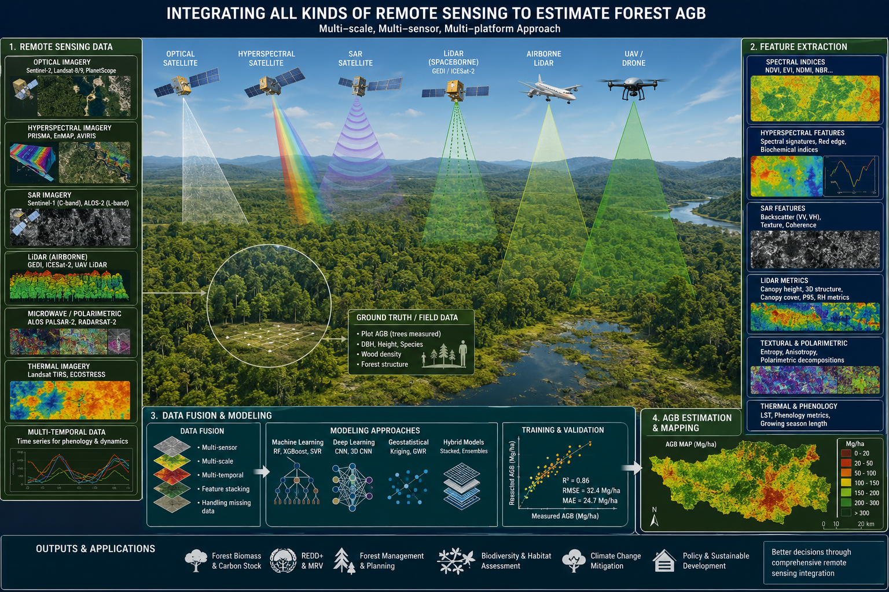

**How can we estimate forest above-ground biomass (AGB) accurately — from a single plot to a whole continent — and know how much to trust the estimate?**

{width="100%" style="border-radius: 6px; margin-bottom: 0.75rem;"}

## Why it matters

Forests store most of the carbon held in terrestrial vegetation, and AGB is the quantity that carbon accounting, forest management and climate policy all depend on. Wall-to-wall AGB maps now exist at national and global scales, but their errors are poorly known at the local scales where land managers, tribal nations and counties actually make decisions. My work asks where those errors come from and how multi-scale LiDAR can reduce them.

## Current projects

### 1 · Local-scale bias in global AGB maps

Global biomass products (e.g. ESA CCI Biomass, GEDI L4B) are increasingly used to report local carbon stocks. I compare these products against local reference estimates to identify **what drives their local-scale bias** — and therefore when a global map can, and cannot, stand in for a local inventory. A case study focuses on forests on Tribal Nations' lands in the U.S.

### 2 · Airborne LiDAR to AGB at NEON sites

A reproducible pipeline linking NEON field plots to airborne LiDAR at **11 forest sites across the U.S.**, from raw point clouds to wall-to-wall 20 m AGB maps. The project replicates a published NEON LiDAR–biomass benchmark and extends it with canopy-complexity metrics and USGS 3DEP LiDAR, with a focus on **how well models transfer to sites they were not trained on**.

- **Data:** NEON AOP discrete-return LiDAR, NEON vegetation-structure plots, USGS 3DEP
- **Approach:** point-cloud normalization (lidR / lasR), height, density and entropy-based complexity metrics, power-law and ensemble ML models, leave-one-site-out validation

### 3 · What controls the accuracy of LiDAR-based biomass? (synthesis)

A systematic review of **121 LiDAR–AGB studies** and a meta-regression of terrestrial laser scanning (TLS) studies, testing whether reconstruction method (quantitative structure models vs. allometry), scanning design and reference data explain the reported accuracy of TLS biomass estimates.

### 4 · Spaceborne LiDAR validation

Evaluating GEDI canopy height (L2A) and biomass (L4A) footprints against airborne LiDAR in forests and cities. The workflows are written up as open notebooks in the [Blog](blog.qmd):
[GEDI L2A at NEON SCBI](posts/gedi-l2a/index.qmd) ·
[GEDI L4A at NEON SCBI](posts/gedi-l4a/index.qmd) ·
[Urban GEDI in New York City](posts/gedi-urban-nyc/index.qmd) ·
[GEDI, 3DEP and OSM heights](posts/gedi-3dep-compare/index.qmd)

## Outputs

- **Preprint** — Chu, D., Yang, H., Constanza, J. K., Yang, J., Murray, B., Mosely, J., & Zhai, L. (2026). *Local-scale bias in global products of forest aboveground biomass related to structural diversity, stand density, and forest age.* SSRN. [doi:10.2139/ssrn.7287457](https://doi.org/10.2139/ssrn.7287457)
- **Poster** — *Understanding the Drivers of Local-Scale Bias in Global Forest Aboveground Biomass Maps.* SAF National Convention, Tacoma, WA, Oct 2026.
- **Talk** — *The factors influencing the accuracy of global forest biomass maps to estimate local carbon storage: a case study of Tribal Nations in the U.S.* Natural Resource Conference, Oklahoma City, Apr 2026.
- **Poster** — *Understanding the Drivers of Local-Scale Bias in Global Forest Aboveground Biomass Maps.* AGU Fall Meeting, New Orleans, Dec 2025.

**Status:** project 1 is available as a preprint; other manuscripts are in preparation.

**Tools:** R (lidR, lasR, terra, sf), Python (scikit-learn, XGBoost, LightGBM, SHAP), Google Earth Engine

::: {.callout-note}
Return to [Research Introduction](projects_intro.qmd) or continue to [Ecosystem Response to Disturbances](projects_disturbance.qmd).
:::
