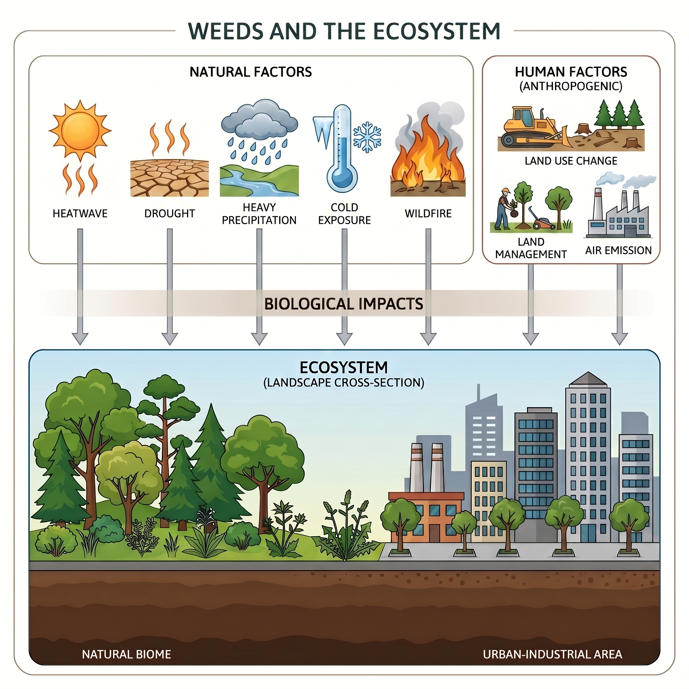
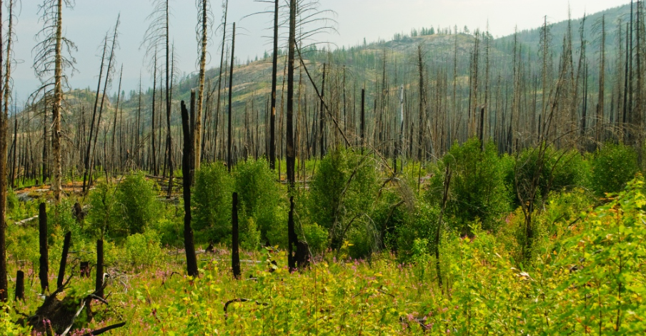

**How do climate extremes and disturbances change the productivity and stability of ecosystems — and what makes some forests more resilient than others?**

## Why it matters

Droughts, heatwaves and other extremes are becoming more frequent and intense. Their effects on carbon uptake are not just a matter of lower averages: extremes make productivity more variable from year to year, which makes the land carbon sink harder to predict and forests harder to manage. Knowing which ecosystems resist, recover from, or are destabilized by extremes is key to forecasting the carbon cycle and to targeting management.

## Current projects

### 1 · Future climate extremes and productivity variability in Central Asia *(published)*

{width="100%" style="border-radius: 6px; margin-bottom: 0.75rem;"}

Using CMIP6 climate projections, this study shows that intensifying climate extremes — droughts, heatwaves and anomalously wet periods — will **amplify the year-to-year swings in net primary production (NPP)** across Central Asia's arid and semi-arid ecosystems, making carbon uptake increasingly unpredictable under future warming.

> Chu, D., Zhang, L., Wu, H., He, H., & Ren, X. (2026). Future climate extremes enhance interannual variability of net primary production in Central Asia. *Environmental Research Letters.* [doi:10.1088/1748-9326/ae6dd4](https://doi.org/10.1088/1748-9326/ae6dd4)

A companion study, led by Han Wu, extends the analysis to the terrestrial carbon sink across China:

> Wu, H., Zhang, L., He, H., Ren, X., Zhang, M., Chu, D., & Zheng, Y. (2025). Enhanced interannual variability of the terrestrial carbon sink in China under high emissions. *Environmental Research Letters.*

### 2 · Forest biomass stability under drought across the U.S.

{width="100%" style="border-radius: 6px; margin-bottom: 0.75rem;"}

Which forests hold their biomass through drought? Using repeated forest inventory across the conterminous U.S., I identify drought events from climatic water deficit and quantify each forest's **resistance, recovery and resilience** in above-ground biomass, then ask how climate, soil, stand structure, structural diversity and plant functional traits shape those responses.

- **Data:** USFS FIA plot network (aggregated to hexagons), seasonal climatic water deficit and vapor pressure deficit, soil and topography layers, TRY plant traits, tree-diversity and structural-diversity products
- **Approach:** event-based stability metrics, interpretable machine learning with permutation-based significance testing

**Status:** manuscript in preparation.

**Tools:** R, Python (scikit-learn, XGBoost, SHAP), Google Earth Engine, CMIP6 / TRENDY model output

::: {.callout-note}
Return to [Forest AGB Estimation](projects_agb.qmd) or continue to [Cooling Effect of Urban Green Space](projects_urban.qmd).
:::
