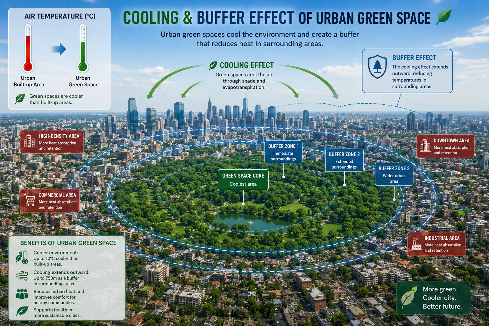

**How much do urban forests and green spaces cool cities, what controls that cooling, and who benefits from it?**

{width="100%" style="border-radius: 6px; margin-bottom: 0.75rem;"}

## Why it matters

Extreme heat is the deadliest weather hazard in the U.S., and cities amplify it. Planting and protecting trees is one of the most widely promoted heat-adaptation strategies, but the cooling a park or urban forest delivers varies enormously from place to place. Planners need to know *which* green spaces cool most, *why*, and whether that cooling is holding up as climate and canopies change.

## Current projects

### 1 · Patterns and drivers of urban forest cooling across U.S. cities

A national analysis of the cooling effect of urban forests across **hundreds of U.S. urbanized areas**. For each forest patch, I measure the land surface temperature (LST) contrast between the forest and its surroundings from a decade of Landsat thermal imagery, track how that cooling changes through time, and model it as a function of:

- **Vegetation structure** — canopy cover, canopy height, greenness, tree diversity
- **Climate** — summer temperature, precipitation, evaporative demand
- **Urban morphology** — building density, height and floor-area ratio around each forest
- **Terrain and soil**

**Data:** Landsat 8/9 LST and NDVI, NLCD tree canopy cover, LCMS land cover and disturbance, global canopy height, building footprints, gridded climate.

**Approach:** quality-controlled cooling profiles in distance rings around each forest, Theil–Sen and mixed-effects trend estimation, interpretable machine learning (SHAP, partial dependence).

### 2 · Heat, air-conditioning access and equity

Surface heat matters most for people who cannot escape it indoors. Combining tract-level air-conditioning prevalence with satellite heat and canopy data across U.S. cities, this project asks where heat exposure and low cooling access overlap — and whether the communities in those places are served by green space.

### 3 · Canopy structure from airborne LiDAR

Using USGS 3DEP airborne LiDAR to characterize the 3-D structure of urban canopies (height, vertical complexity, gaps) and buildings, so cooling can be linked to structure rather than to 2-D cover alone. See the [LiDAR metrics](posts/lidar-metrics/index.qmd) and [urban GEDI](posts/gedi-urban-nyc/index.qmd) posts for the processing workflow.

## Outputs

- **Talk (30 min)** — *Patterns and Drivers of Urban Forest Cooling Across U.S. Cities.* SAF National Convention, Tacoma, WA, Oct 2026.
- **Proposal** — NASA FINESST fellowship application on multi-scale LiDAR and urban cooling (2026).

**Status:** manuscripts in preparation.

**Tools:** R (lidR, terra, sf, lme4), Python (xarray, rasterio, scikit-learn, XGBoost, SHAP), Google Earth Engine

::: {.callout-note}
Return to [Ecosystem Response to Disturbances](projects_disturbance.qmd) or go back to [Research Introduction](projects_intro.qmd).
:::
